<a id="topo"></a>

<div align="center">


**Projeto Integrador II · FATEC · Análise e Desenvolvimento de Sistemas**

<br>


<br>

[🎯 Sobre](#sobre) ·
[✨ Funcionalidades](#funcionalidades) ·
[🔄 Fluxos](#fluxos) ·
[🏗️ Arquitetura](#arquitetura) ·
[🛠️ Tecnologias](#tecnologias) ·
[🗄️ Banco](#banco) ·
[🔌 API](#api) ·
[🖥️ Telas](#telas) ·
[🔐 Segurança](#seguranca) ·
[🚀 Como rodar](#como-rodar) ·
[👥 Equipe](#equipe)

</div>

<br>

> [!TIP]
> **Quer ver funcionando em 1 minuto?** Vá direto para [🚀 Como rodar](#como-rodar), entre como administrador (`admin@teste.com` / `Admin@123456`) e confirme um pedido: o estoque baixa, a movimentação aparece no histórico e, ao entregar, a venda nasce sozinha.

---

<a id="sumario"></a>

## 📑 Sumário

<details>
<summary><b>Clique para abrir o sumário completo</b></summary>

<br>

| Conhecer o projeto | Por dentro do sistema | Como foi feito | Usar e evoluir |
|---|---|---|---|
| [🎯 Sobre o projeto](#sobre) | [🏗️ Arquitetura](#arquitetura) | [🧭 O que mudou na reforma](#reforma) | [🚀 Como rodar o projeto](#como-rodar) |
| [🥅 Objetivo](#objetivo) | [🔑 Como funciona o login](#login) | [⚖️ Decisões: porquês, vantagens e desvantagens](#decisoes) | [📋 Pré-requisitos](#pre-requisitos) |
| [🧩 O problema que resolvemos](#problema) | [🛠️ Tecnologias](#tecnologias) | [🧗 Desafios, problemas e dificuldades](#desafios) | [📂 Estrutura de pastas](#pastas) |
| [📊 O projeto em números](#numeros) | [🗄️ Banco de dados](#banco) | [🔍 Pontos que podem melhorar](#pontos-melhorar) | [🤝 Fluxo de trabalho da equipe](#fluxo-trabalho) |
| [✨ Funcionalidades](#funcionalidades) | [🔌 API (back-end)](#api) | [📋 Engenharia de requisitos e diagramas](#requisitos) | [📈 Status e roadmap](#status) |
| [🔄 Fluxo comercial e administrativo](#fluxos) | [🖥️ Telas (front-end) e prints](#telas) | [✅ Qualidade e desempenho](#qualidade) | [🗓️ Cronograma](#cronograma) |
| [🔁 Ciclo de vida de um pedido](#ciclo) | [🔐 Segurança da informação](#seguranca) | | [🔭 Melhorias futuras](#melhorias-futuras) |
| | | | [👥 Equipe](#equipe) · [📄 Licença](#licenca) |

</details>

---

<a id="sobre"></a>

## 🎯 Sobre o projeto

O **PI-2** é uma aplicação web completa feita para um **cliente real**: a **S Ferraretto**, empresa de Salto-SP que comercializa paletes de madeira, principalmente para outras empresas (B2B), com retirada na loja.

<table>
<tr>
<td width="62%" valign="top">

| 🏢 Cliente | |
|---|---|
| **Razão social** | Ferraretto Comércio e Consultoria Empresarial LTDA |
| **Nome fantasia** | S FERRARETTO |
| **CNPJ** | 30.669.871/0001-63 |
| **Endereço** | R. Batalha do Tuiuti, 1850 - Distrito Industrial, Salto-SP, 13329-422 |
| **Ramo (CNAE)** | 4744-0/02 · Comércio varejista de madeira e artefatos |
| **Atendimento** | Segunda a sexta, das 7h às 18h · WhatsApp (11) 97216-7974 |

</td>
<td width="38%" valign="top">

**O sistema reúne em um só lugar:**

🌐 **Divulgação**<br>
Landing page confiável e catálogo aberto a qualquer pessoa

🛒 **Canal de vendas**<br>
Carrinho e pedido pelo site, com data de retirada

📦 **Gestão**<br>
Painel com pedidos, estoque, vendas, notas fiscais e usuários

</td>
</tr>
</table>

> [!NOTE]
> O projeto nasceu de uma **entrevista com o proprietário** e de uma **visita ao armazém**, para entender na prática como a operação funciona hoje: pedidos chegam pelo WhatsApp, o estoque é controlado "de cabeça" e a nota fiscal é emitida no site **Emitte**.

<a id="objetivo"></a>

### 🥅 Objetivo

Entregar um sistema **profissional, confiável e fácil de usar** que:

1. **Divulgue** a empresa e os produtos na internet, com os dados oficiais (CNPJ, endereço, WhatsApp, horário);
2. **Receba pedidos** sem depender de mensagens soltas no WhatsApp;
3. **Controle o estoque** com histórico de cada entrada e saída (quem fez, quando, por quê e de qual pedido);
4. **Organize o ciclo comercial** inteiro: pedido → venda → nota fiscal;
5. Seja **seguro** desde a base: senhas criptografadas, permissões conferidas no servidor e validação de todos os dados.

<a id="problema"></a>

### 🧩 O problema que resolvemos

| # | Dor do cliente | Como era | Como o sistema resolve |
|:-:|----------------|----------|------------------------|
| 1️⃣ | **Falta de divulgação** | Sem site; clientes só conheciam a loja por indicação | Landing page com produtos, "como funciona", mapa, CNPJ e WhatsApp + catálogo aberto, sem login |
| 2️⃣ | **Falta de gerenciamento de estoque** | Saldo controlado de memória ou em papel | Estoque baixa sozinho ao confirmar o pedido; cada movimento fica no histórico com responsável e motivo; alerta de estoque baixo |
| 3️⃣ | **Falta de canal de vendas** | Pedidos espalhados no WhatsApp | Carrinho, envio do pedido com data de retirada e recado, acompanhamento do status pelo cliente |

<a id="numeros"></a>

### 📊 O projeto em números

<div align="center">

| 🔌 Rotas da API | 🖥️ Telas | 🗄️ Tabelas | 🔀 Pull Requests | 🧾 Commits | 🪜 Etapas da reforma | 🧪 Passos no roteiro de teste |
|:---:|:---:|:---:|:---:|:---:|:---:|:---:|
<!-- METRICAS-AUTOMATICAS:INICIO -->
| **30** | **15** | **8** | **55** | **243** | **12** | **~60** |
<!-- METRICAS-AUTOMATICAS:FIM -->
<sub>Commits na branch principal, excluindo as atualizações automáticas desta tabela. Pull Requests abertos e fechados.</sub>

</div>

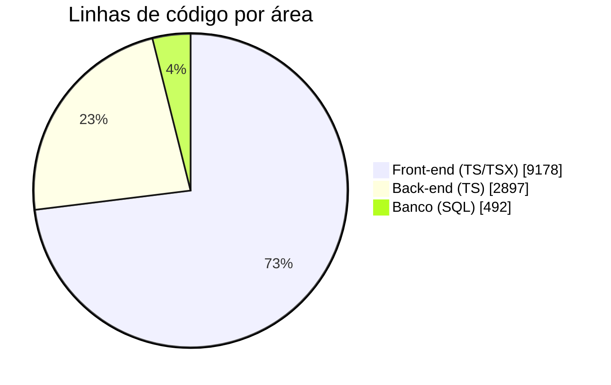

<div align="right"><a href="#topo">⬆️ voltar ao topo</a></div>

---

<a id="funcionalidades"></a>

## ✨ Funcionalidades

<table>
<tr>
<td width="33%" valign="top">

### 🌐 Visitante (sem login)

- 🏠 Landing page com produtos, "Como funciona o pedido", "Sobre" e mapa
- 🛍️ **Catálogo aberto**, com preço e "Disponível" / "Esgotado"
- 🔎 "Saber mais": janela só com os detalhes do produto
- ➕ Escolher a quantidade e **adicionar ao carrinho** direto no card
- 🛒 Página do carrinho (o carrinho fica guardado no navegador)
- 💬 Botões de WhatsApp com mensagem pronta
- 📝 Cadastro com qualquer tipo de e-mail

</td>
<td width="33%" valign="top">

### 👤 Cliente

- 🔑 Login e edição de perfil (nome e senha)
- 📦 **Enviar o pedido** do carrinho, com data de retirada (até 60 dias) e observação (até 500 caracteres)
- ↩️ Depois do login, volta direto para o carrinho, com os itens
- 🔎 **Meus Pedidos**: histórico completo com status colorido e itens
- ❌ Cancelar o pedido enquanto ele está **pendente**
- 🙈 Não vê a quantidade em estoque (sigilo comercial da loja)

</td>
<td width="33%" valign="top">

### 🛠️ Administrador

- 🧭 Painel próprio (`/admin`) com menu lateral (gaveta no celular)
- 📊 **Dashboard**: pendentes, a retirar hoje, estoque baixo e vendas do mês
- 📋 Mudar status: confirmar → pronto → entregue, ou cancelar
- 🔎 Tabela de **pedidos** com busca, status, período, ordenação e soma
- 📦 **Movimentações**: histórico + entrada/saída manual com motivo
- 💰 **Vendas**: total, média e "Emitir nota"
- 🧾 **Notas fiscais**: status, link do PDF, editar link e cancelar
- 👥 **Usuários**: perfil, nº de pedidos e total comprado
- 👤 Perfil do administrador

</td>
</tr>
</table>

<details>
<summary><b>🔎 Ver os detalhes de cada funcionalidade do administrador</b></summary>

<br>

| Tela | O que dá para fazer |
|------|---------------------|
| **Dashboard** | 4 cartões (pendentes · a retirar hoje · estoque baixo ≤ 10 un. · vendas do mês) + lista de pedidos em andamento com filtros (Todos/Pendentes/Confirmados/Prontos), cliente, observação, data de retirada ("Hoje" destacado), itens em janela e botões de status com confirmação antes de cancelar e de entregar |
| **Pedidos** | Todos os status; busca por nº ("12" ou "nº 12"), nome ou e-mail, sem diferenciar acento; período "Feito de / Até"; chips de status com contagem; ordenação por data ou valor; "Mostrando X de Y · soma" |
| **Usuários** | Busca por nome/e-mail; filtro Clientes/Administradores; ordenação por cadastro, nome, mais pedidos ou maior valor comprado. A senha nunca sai do banco |
| **Movimentações** | Formulário de entrada/saída com saldo atual, prévia "Estoque fica em X", aviso de estoque insuficiente e confirmação antes da saída; histórico com busca, produto, período e chips Todas/Entradas/Saídas/Manuais |
| **Vendas** | Busca por venda/pedido/cliente/nota; período; Com/Sem nota; total e média; itens em janela; "Emitir nota" para vendas sem nota |
| **Notas fiscais** | Emitidas/Canceladas; soma das emitidas; "Abrir PDF" (nova aba, com `noopener`); adicionar/editar link; cancelar com confirmação (a venda volta a aceitar uma nota nova) |
| **Perfil** | Trocar nome e senha (pede a senha atual); mostra a data de criação da conta |

</details>

<div align="right"><a href="#topo">⬆️ voltar ao topo</a></div>

---

<a id="fluxos"></a>

## 🔄 Fluxo comercial e fluxo administrativo

### 🛒 Fluxo comercial (visão geral)

```mermaid
flowchart LR
    V(["🌐 Visitante"]) --> L["🏠 Landing"] --> C["🛍️ Catálogo"] --> K["🛒 Carrinho"]
    K -- "login de cliente" --> P["📦 Pedido<br/>pendente"]
    P -- "admin confirma" --> E["📉 Estoque baixa<br/>+ movimentação"]
    E --> R["📍 Pronto para<br/>retirada"] -- "cliente retira" --> VD["💰 Venda<br/>(automática)"]
    VD --> NF["🧾 Nota fiscal<br/>(Emitte + link)"]

    style V fill:#e0f2fe,stroke:#0284c7,color:#111
    style P fill:#fef3c7,stroke:#d97706,color:#111
    style E fill:#fee2e2,stroke:#dc2626,color:#111
    style VD fill:#dcfce7,stroke:#16a34a,color:#111
    style NF fill:#dcfce7,stroke:#16a34a,color:#111
```

### 🛠️ Fluxo administrativo (o dia a dia da loja)

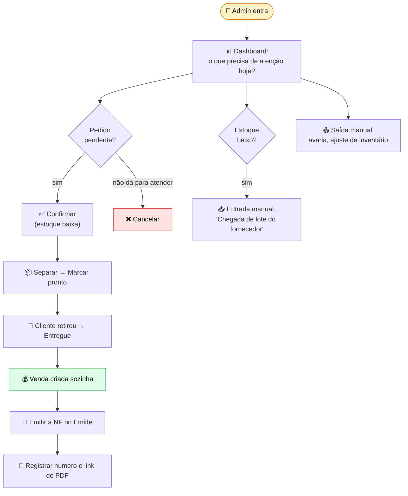

<a id="ciclo"></a>

### 🔁 Ciclo de vida de um pedido

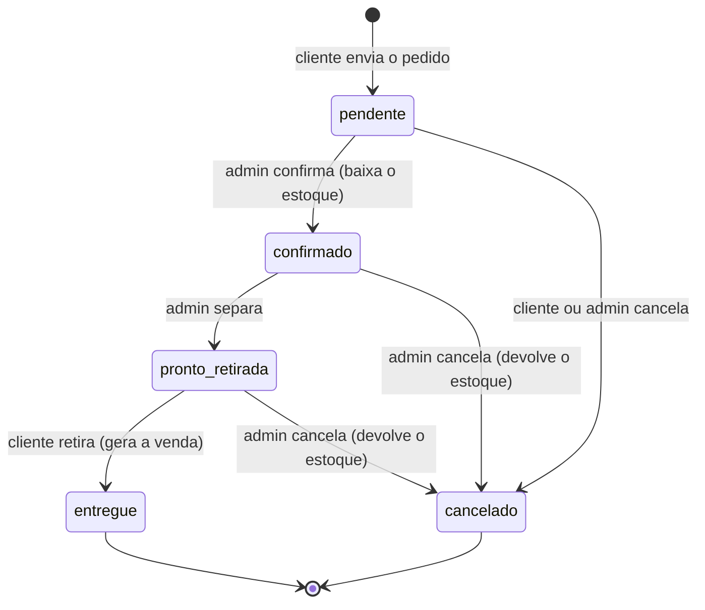

| Mudança | O que acontece no banco (tudo na mesma **transação**) |
|---------|-------------------------------------------------------|
| Cliente envia | Confere se cada produto existe, está ativo e tem estoque; grava `pedido` + `pedido_item` com o preço do momento. **O estoque ainda não muda** |
| Admin **confirma** | Confere o estoque de novo e grava uma **saída** por item ("Confirmação do pedido nº X"), com o admin como responsável |
| Admin **cancela** um confirmado/pronto | Grava uma **entrada** por item ("Cancelamento do pedido nº X (estoque devolvido)") |
| Admin marca **entregue** | Cria a **venda** com o valor total do pedido |
| Fora da ordem (ex.: pendente → entregue) | Recusado com `409` e mensagem em português |

> [!IMPORTANT]
> O cliente só cancela pelo site enquanto o pedido está **pendente**. Depois de confirmado, o estoque já foi separado e só o administrador pode cancelar (o site orienta a falar com a loja pelo WhatsApp).

<div align="right"><a href="#topo">⬆️ voltar ao topo</a></div>

---

<a id="arquitetura"></a>

## 🏗️ Arquitetura

O sistema tem **três partes independentes** que conversam entre si: o site (front-end), a API (back-end) e o banco de dados.

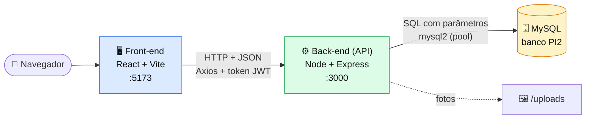

> **Analogia:** o front-end é o **balcão** da loja (o que o cliente vê), o back-end é o **gerente** (confere regras e permissões) e o banco é o **arquivo** onde tudo fica guardado. O cliente nunca mexe no arquivo direto: sempre passa pelo gerente.

### 🧱 Camadas do back-end

Cada camada tem **uma única responsabilidade**. Uma requisição passa por todas, nesta ordem:

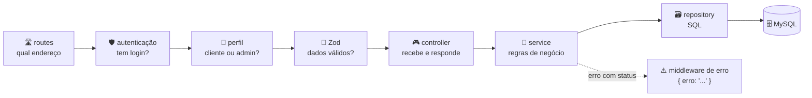

| Camada | Pasta | Responsabilidade | Exemplo real |
|--------|-------|------------------|--------------|
| Rotas | `routes/` | Define o endereço e a fila de middlewares | `PATCH /pedidos/:id/status` → só admin |
| Middlewares | `middlewares/` | Login (JWT), perfil, validação, limite de login e erros | `autenticacaoMiddleware`, `autorizarAdministrador` |
| Schemas | `schemas/` | Regras dos dados de entrada (Zod) | data de retirada de hoje até 60 dias |
| Controllers | `controllers/` | Lê a requisição e devolve a resposta HTTP | devolve `201 { pedidoId }` |
| Services | `services/` | Regras de negócio e transações | confirmar baixa o estoque |
| Repositories | `repositories/` | Consultas SQL com parâmetros `?` | `SELECT ... FOR UPDATE` |

### 🔗 Tudo conversando: da tela até a tabela

Exemplo do administrador confirmando o pedido nº 16:

```text
Dashboard (botão "Confirmar")
  → pedidoApi.ts (Axios, com "Authorization: Bearer <token>")
    → PATCH /pedidos/16/status   { "status": "confirmado" }
      → autenticacaoMiddleware (token válido? usuário existe?)
        → autorizarAdministrador (perfil = administrador?)
          → validarSchema(IdParamSchema + AlterarStatusPedidoSchema)
            → PedidoController.AlterarStatus
              → PedidoService.AlterarStatus (transação)
                → PedidoRepository / EstoqueRepository
                  → tabelas pedido, produto, movimentacao_estoque
```

<details>
<summary><b>⚙️ Sequência da confirmação de um pedido (com transação e trava)</b></summary>

<br>

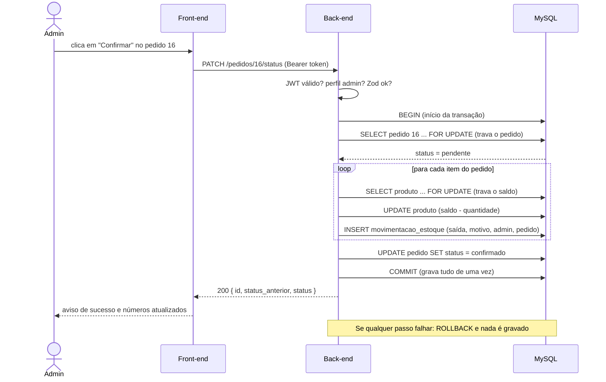

</details>

<a id="login"></a>

### 🔑 Como funciona o login (sequência)

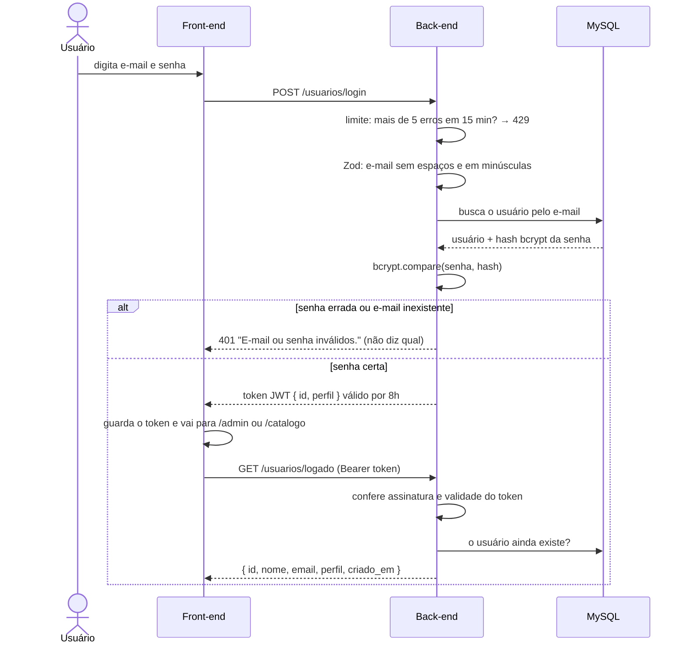

> **Analogia:** o **JWT** é como a pulseira de um evento: o servidor entrega na entrada (login), ela tem a "assinatura" do evento (o `JWT_SECRET`) e vale por 8 horas. Em cada porta (rota), o segurança olha a pulseira, sem precisar perguntar a senha de novo.

<div align="right"><a href="#topo">⬆️ voltar ao topo</a></div>

---

<a id="tecnologias"></a>

## 🛠️ Tecnologias

<div align="center">


<br>


<br>


</div>

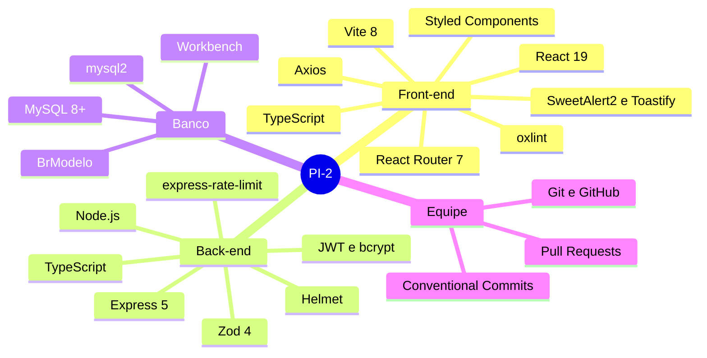

<table>
<tr>
<td width="50%" valign="top">

**🖥️ Front-end**

| Tecnologia | Para que serve |
|------------|----------------|
| React 19 + TypeScript | Monta as telas em componentes; o TypeScript avisa erros antes de rodar |
| Vite 8 | Servidor de desenvolvimento rápido e build de produção |
| React Router 7 | Endereços das telas e rotas protegidas por perfil |
| Styled Components 6 | CSS dentro de cada componente |
| Axios | Chamadas à API (coloca o token em toda requisição) |
| SweetAlert2 + React Toastify | Janelas de confirmação e avisos rápidos |
| React Icons | Ícones |
| oxlint 1.91 | Procura erros e más práticas no código `.ts/.tsx` |

</td>
<td width="50%" valign="top">

**⚙️ Back-end**

| Tecnologia | Para que serve |
|------------|----------------|
| Node.js + Express 5 + TypeScript | Servidor da API |
| mysql2 | Conexão com o MySQL (pool + *prepared statements*) |
| jsonwebtoken | Gera e confere o token de login (JWT) |
| bcrypt | Guarda a senha como hash (não dá para "desfazer") |
| Zod 4 | Valida os dados que chegam, com mensagens em português |
| dotenv + cors | Configurações no `.env` e só o site pode chamar a API |
| helmet 8.3 | Cabeçalhos de segurança em todas as respostas |
| express-rate-limit 8.7 | Bloqueia força bruta no login |
| tsx | Roda o TypeScript com recarga automática (`npm run dev`) |

</td>
</tr>
</table>

**🧰 Ferramentas:** VS Code · MySQL Workbench · BrModelo · Git e GitHub · arquivos `.http` (em `backend/requests/`) para testar a API

<div align="right"><a href="#topo">⬆️ voltar ao topo</a></div>

---

<a id="banco"></a>

## 🗄️ Banco de dados

Banco **MySQL** chamado `PI2`, com **8 tabelas** em uso. DDL em [`schema.sql`](backend/src/database/schema.sql), DML (dados de demonstração) em [`seed.sql`](backend/src/database/seed.sql) e DQL (consultas da loja) em [`consultas.sql`](backend/src/database/consultas.sql).

> **Sem atributos derivados:** o banco não guarda subtotal nem valor total. Eles são calculados nas consultas com `SUM(quantidade * preco_unitario)`. O `preco_unitario` de cada item fica guardado porque é o preço **no dia da compra**.

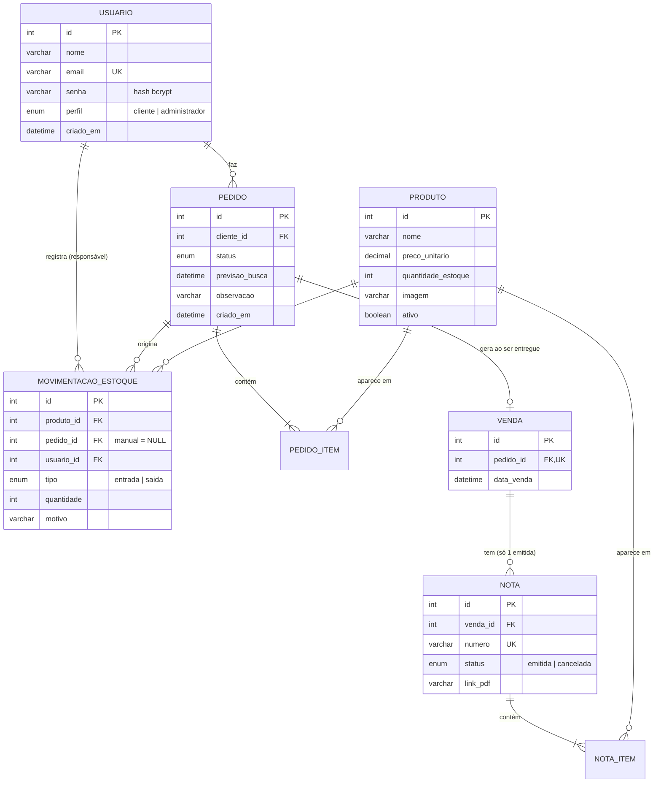

> O modelo com **todas** as colunas, a lista para refazer o MER no BrModelo e o diagrama de classes estão em [**docs/diagramas.md**](docs/diagramas.md).

<details>
<summary><b>📚 Dicionário das tabelas</b></summary>

<br>

| Tabela | O que guarda | Regras importantes |
|--------|--------------|--------------------|
| `usuario` | Clientes e administradores | `email` único; `senha` só como hash; `perfil` sempre `cliente` no cadastro |
| `produto` | Paletes do catálogo | Nunca é apagado: `ativo = false` tira do catálogo e preserva o histórico |
| `pedido` | Pedido do cliente | `status`: pendente, confirmado, pronto_retirada, entregue, cancelado; `previsao_busca` e `observacao` opcionais |
| `pedido_item` | Itens do pedido | Guarda o **preço do momento** (mudar o preço depois não altera pedidos antigos) |
| `venda` | Venda de um pedido entregue | `pedido_id` único: um pedido gera no máximo uma venda |
| `nota` / `nota_item` | Nota fiscal emitida no Emitte | `numero` único (nem cancelada reaproveita); só **uma emitida** por venda; `link_pdf` só `http/https` |
| `movimentacao_estoque` | Histórico de entradas e saídas | Responsável (`usuario_id`), `motivo` e pedido de origem (`pedido_id`; manual = vazio) |

`telefone` e `endereco` estão **planejadas** (comentadas no `schema.sql`) para a melhoria futura de telefone no cadastro e frete.

</details>

<details>
<summary><b>🌱 Dados de demonstração (seed.sql)</b></summary>

<br>

| Dado | Quantidade | Detalhe |
|------|:----------:|---------|
| Usuários | 8 | 1 admin + 7 clientes fictícios (empresas e pessoas, com e-mails gmail, hotmail, outlook, yahoo e `.com.br`) |
| Produtos | 5 | 3 ativos no catálogo: Palete Cavinha (R$ 42), Palete Euro (EPAL) (R$ 48) e Palete PBR (R$ 65). Palete plástico e Palete descartável saíram de linha (inativos, estoque 0): guardam o histórico e não aparecem no catálogo |
| Pedidos | 15 | Todos os status: 3 pendentes, 2 confirmados, 2 prontos, 6 entregues, 2 cancelados |
| Vendas | 6 | 4 com nota e 2 sem nota (para mostrar "Emitir nota") |
| Notas | 5 | NF-000001 a NF-000005, uma cancelada e reemitida |
| Movimentações | 27 | Estoque inicial, lotes, avaria, ajuste, saídas de pedidos, devolução e produtos que saíram de linha |
| Itens | 19 + 7 | Itens dos pedidos e itens das notas (todas as 8 tabelas têm 5 registros ou mais) |

- As datas são **relativas ao dia em que o seed roda** (`NOW() - INTERVAL 10 DAY`): o painel sempre tem "retirar hoje" e "vendas do mês".
- O estoque de cada produto é **exatamente** a soma das movimentações (entradas − saídas). Apenas os três produtos ativos aparecem no catálogo e entram no alerta de estoque baixo.

</details>

<div align="right"><a href="#topo">⬆️ voltar ao topo</a></div>

---

<a id="api"></a>

## 🔌 API (back-end)

**30 rotas** em 7 grupos. 🌐 = pública · 🔒 = exige `Authorization: Bearer <token>` · **Legenda:** 🟢 `GET` · 🔵 `POST` · 🟣 `PUT` · 🟠 `PATCH`

<details open>
<summary><b>👤 Usuários</b> (4)</summary>

<br>

| Método | Rota | Descrição | Acesso |
|:------:|------|-----------|:------:|
| 🔵 `POST` | `/usuarios` | Cadastro (sempre como cliente) `{ nome, email, senha }` | 🌐 |
| 🔵 `POST` | `/usuarios/login` | Login → `{ token, payload }`. 5 erros em 15 min → `429` | 🌐 |
| 🟢 `GET` | `/usuarios/logado` | `{ usuario: { id, nome, email, perfil, criado_em } }` | 🔒 |
| 🟠 `PATCH` | `/usuarios` | Atualizar nome e/ou senha (`senhaAtual` + `senhaNova`) | 🔒 |

</details>

<details open>
<summary><b>📦 Produtos</b> (6)</summary>

<br>

| Método | Rota | Descrição | Acesso |
|:------:|------|-----------|:------:|
| 🟢 `GET` | `/produtos` | Catálogo: produtos ativos com `disponivel: true/false` (**sem** a quantidade) | 🌐 |
| 🟢 `GET` | `/produtos/:id` | Detalhes de um produto ativo (`404` se não existe ou está desativado) | 🌐 |
| 🟢 `GET` | `/produtos/todos` | Todos, inclusive desativados, com `quantidade_estoque` | 🔒 admin |
| 🔵 `POST` | `/produtos` | Cadastrar `{ nome, descricao, preco, quantidade, imagem? }` → `201 { id }` | 🔒 admin |
| 🟣 `PUT` | `/produtos/:id` | Editar (mesmo corpo) → `204` | 🔒 admin |
| 🟠 `PATCH` | `/produtos/:id/ativo` | Ativar/desativar `{ "ativo": false }` → `204` | 🔒 admin |

</details>

<details open>
<summary><b>🛒 Pedidos</b> (7)</summary>

<br>

| Método | Rota | Descrição | Acesso |
|:------:|------|-----------|:------:|
| 🔵 `POST` | `/pedidos` | Criar pedido → `201 { pedidoId }` | 🔒 cliente |
| 🟢 `GET` | `/pedidos/cliente` | Pedidos do cliente logado, com `valor_total` | 🔒 cliente |
| 🟢 `GET` | `/pedidos/itens/:id` | Itens de um pedido **do próprio** cliente | 🔒 cliente |
| 🟠 `PATCH` | `/pedidos/cancelar/:id` | Cancelar (só `pendente`) → `204` | 🔒 cliente |
| 🟢 `GET` | `/pedidos` | Todos os pedidos, com nome e e-mail do cliente | 🔒 admin |
| 🟢 `GET` | `/pedidos/:id/itens` | Itens de qualquer pedido | 🔒 admin |
| 🟠 `PATCH` | `/pedidos/:id/status` | `{ "status": "confirmado" }` → `200 { id, status_anterior, status }` | 🔒 admin |

Corpo de `POST /pedidos`:

```json
{
  "itens": [{ "produto_id": 1, "quantidade": 10 }],
  "previsao_busca": "2026-11-25",
  "observacao": "Vou buscar com caminhão no fim da tarde."
}
```

- Itens: de 1 a 50, sem repetir produto, quantidade inteira > 0. `previsao_busca`: de hoje até 60 dias, data real. `observacao`: até 500 caracteres.
- Estoque insuficiente → `409` "No momento não temos essa quantidade de ..." (**sem revelar o saldo**). Produto desativado → `409`. Inexistente → `404`.

</details>

<details>
<summary><b>🧭 Painel, 💰 Vendas, 🧾 Notas e 📊 Estoque</b> (13, todas só para administrador)</summary>

<br>

| Método | Rota | Descrição |
|:------:|------|-----------|
| 🟢 `GET` | `/admin/resumo` | `{ pendentes, retirar_hoje, limite_estoque_baixo, estoque_baixo[], vendas_mes }` |
| 🟢 `GET` | `/admin/usuarios` | Usuários sem senha, com `total_pedidos` e `total_comprado` |
| 🟢 `GET` | `/vendas` | Vendas com cliente, quantidade e nota emitida (`null` = sem nota) |
| 🔵 `POST` | `/vendas` | Registrar venda de um pedido `entregue` antigo que ficou sem venda `{ pedido_id }` |
| 🟢 `GET` | `/notas` | Notas com venda, pedido e cliente |
| 🔵 `POST` | `/notas` | `{ venda_id, numero, natureza_operacao?, link_pdf? }` → `201` |
| 🟠 `PATCH` | `/notas/:id/link` | Trocar ou apagar o link do PDF |
| 🟠 `PATCH` | `/notas/:id/cancelar` | Cancelar a nota (fica no histórico) |
| 🟢 `GET` | `/estoque` | Saldo de todos os produtos |
| 🟢 `GET` | `/estoque/movimentacoes` | Histórico com `responsavel_nome`, `motivo` e `pedido_id` |
| 🟢 `GET` | `/estoque/movimentacoes/:id` | Saldo e histórico de um produto |
| 🔵 `POST` | `/estoque/entrada` | `{ produto_id, quantidade, motivo }` (motivo de 3 a 255 caracteres) |
| 🔵 `POST` | `/estoque/saida` | Mesmo corpo; saída maior que o saldo → `409` |

Regras das notas: número até 30 caracteres (letras, números, `.`, `/`, `-`) e nunca repetido → `409`; `link_pdf` só aceita `http://` ou `https://` (bloqueia `javascript:`) → `400`; venda que já tem nota emitida → `409`. O responsável de cada movimentação vem **do token**, nunca do corpo da requisição.

</details>

<details>
<summary><b>⚠️ Padrão de erros (igual em toda a API)</b></summary>

<br>

```json
{ "erro": "Dados inválidos", "detalhes": [ { "message": "Informe um e-mail válido, como nome@exemplo.com." } ] }
```

| Código | Quando | Exemplo de mensagem |
|:------:|--------|---------------------|
| `400` | Dados inválidos (Zod) ou JSON mal formado | "A data de retirada não pode ser no passado." |
| `401` | Sem login, token inválido ou vencido | "Sua sessão expirou. Faça login novamente." |
| `403` | Sem permissão (perfil errado) ou outro site (CORS) | "Acesso permitido somente para administradores." |
| `404` | Não encontrado (inclusive rota inexistente) | "Pedido não encontrado." |
| `409` | Conflito com a regra de negócio | "Não é possível mudar o pedido de "pendente" para "entregue"." |
| `429` | Muitas tentativas de login | "Muitas tentativas de login. Por segurança, tente novamente em 15 minutos." |
| `500` | Erro inesperado (detalhe só no terminal) | "Erro interno no servidor" |

O front-end mostra sempre o detalhe em português (função `obterMensagemErro`) e avisa quando o servidor está fora do ar.

</details>

<div align="right"><a href="#topo">⬆️ voltar ao topo</a></div>

---

<a id="telas"></a>

## 🖥️ Telas (front-end)

| Rota | Tela | Quem abre |
|------|------|:---------:|
| `/` | Tela inicial (landing) | 🌐 Todos |
| `/catalogo` | Catálogo com quantidade e carrinho no card | 🌐 Todos |
| `/carrinho` | Carrinho, data de retirada, observação e envio | 🌐 Todos (enviar exige cliente) |
| `/cadastro` · `/login` | Cadastro e login | 🌐 Visitante |
| `/perfil` | Perfil do cliente | 🔒 Cliente |
| `/clientePedidos` | Meus Pedidos | 🔒 Cliente |
| `/admin` | Dashboard | 🔒 Admin |
| `/admin/pedidos` | Tabela de pedidos | 🔒 Admin |
| `/admin/usuarios` | Tabela de usuários | 🔒 Admin |
| `/admin/movimentacoes` | Movimentações de estoque | 🔒 Admin |
| `/admin/vendas` | Tabela de vendas | 🔒 Admin |
| `/admin/notas` | Tabela de notas fiscais | 🔒 Admin |
| `/admin/perfil` | Perfil do administrador | 🔒 Admin |
| qualquer outro | Página 404 (o painel tem a sua própria) | 🌐 Todos |

### 📸 Prints

Capturas com os dados do `seed.sql` (todas em [`docs/prints/`](docs/prints)).

<table>
<tr>
<td width="50%" align="center">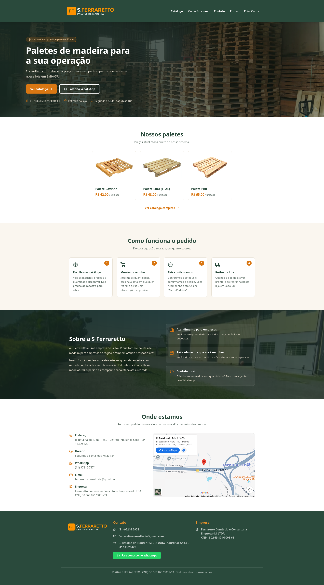<br><sub><b>Tela inicial</b>: CNPJ, horário, WhatsApp e catálogo</sub></td>
<td width="50%" align="center"><br><sub><b>Catálogo aberto</b>: quantidade e carrinho direto no card</sub></td>
</tr>
<tr>
<td align="center"><br><sub><b>Carrinho</b>: data de retirada e observação</sub></td>
<td align="center"><br><sub><b>Meus Pedidos</b>: histórico com status</sub></td>
</tr>
<tr>
<td align="center"><br><sub><b>Dashboard</b>: indicadores e pedidos em andamento</sub></td>
<td align="center">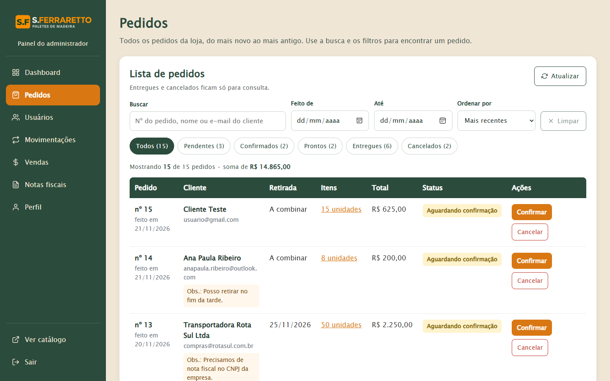<br><sub><b>Pedidos</b>: busca, filtros e status</sub></td>
</tr>
<tr>
<td align="center">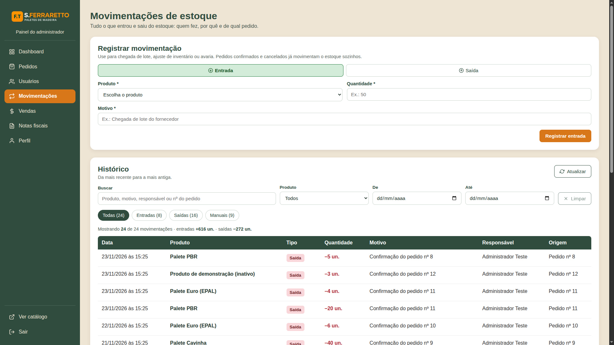<br><sub><b>Movimentações</b>: quem, quando, por quê e de qual pedido</sub></td>
<td align="center"><br><sub><b>Vendas</b>: total, média e "Emitir nota"</sub></td>
</tr>
<tr>
<td align="center">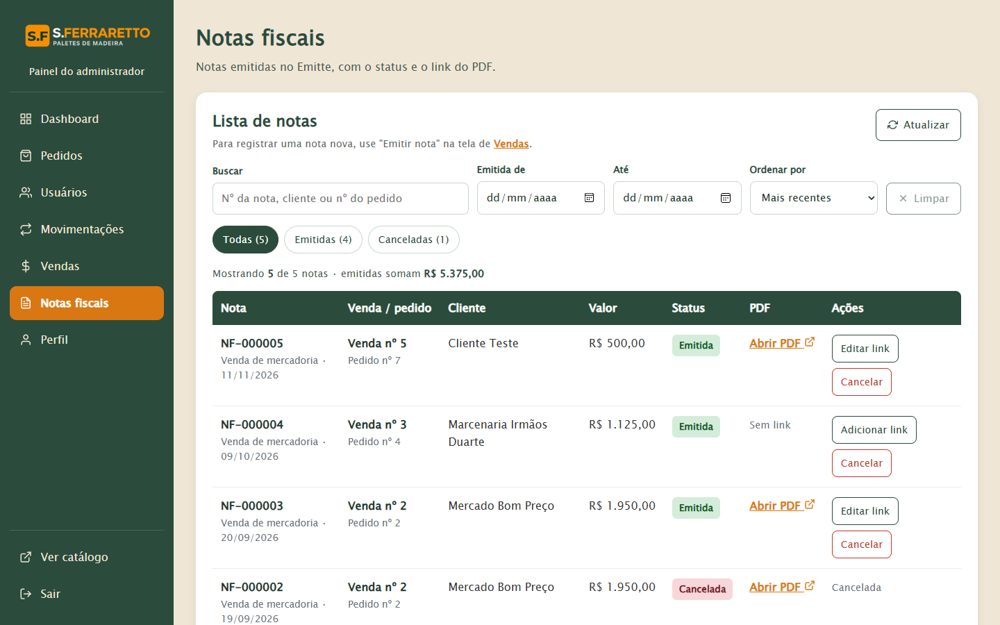<br><sub><b>Notas fiscais</b>: status e link do PDF no Emitte</sub></td>
<td align="center"><br><sub><b>Usuários</b>: perfil, nº de pedidos e total comprado</sub></td>
</tr>
</table>

<details>
<summary><b>📱 Mais prints (login e celular)</b></summary>

<br>

<p align="center">
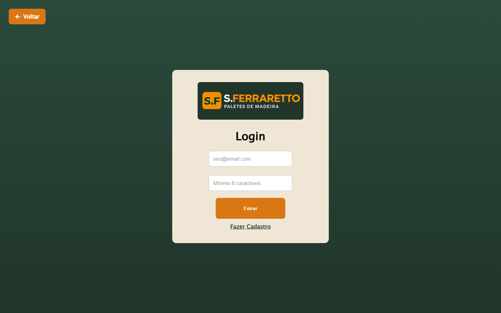
&nbsp;
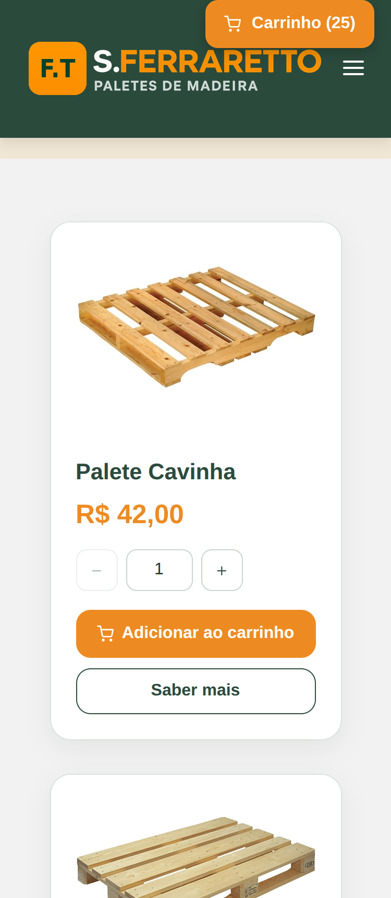
</p>

</details>

<a id="acesso-telas"></a>

### 🔐 Quem pode abrir cada tela

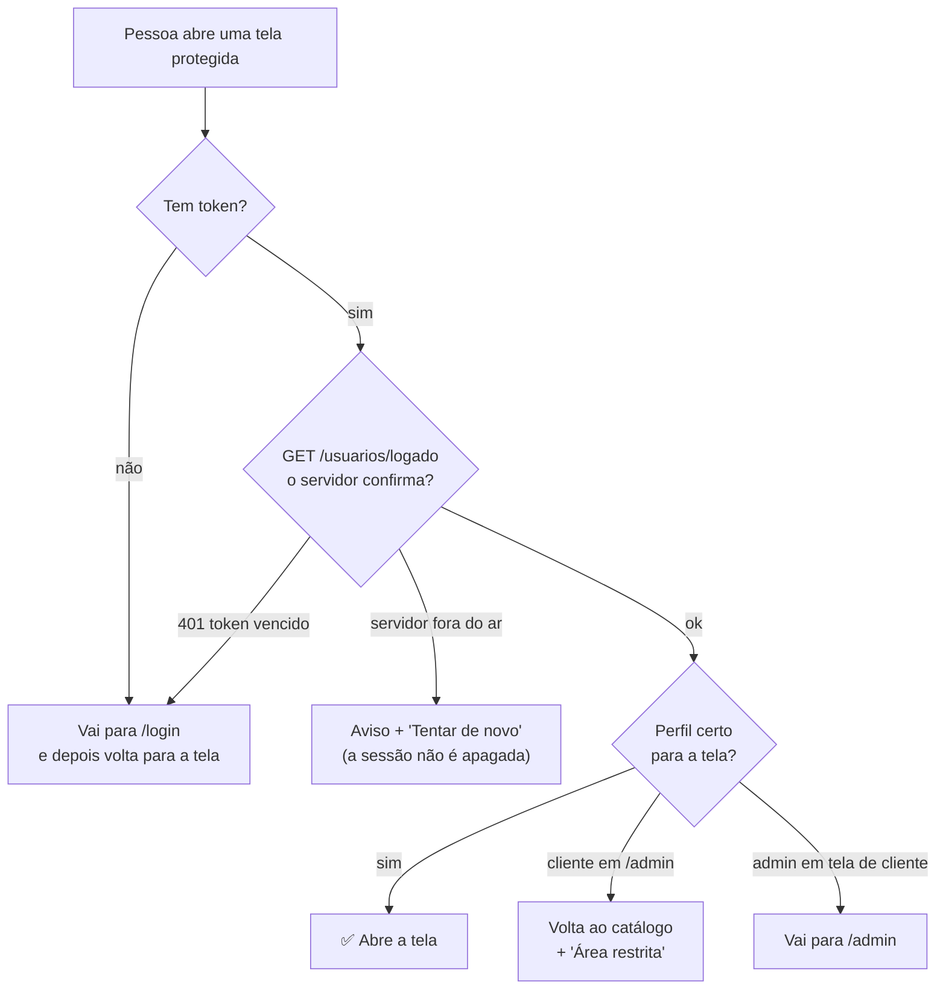

> [!IMPORTANT]
> Quem decide é o **servidor**. O front-end só ajuda na navegação: mesmo que alguém force o endereço ou altere o navegador, a API responde `401`/`403`.

<div align="right"><a href="#topo">⬆️ voltar ao topo</a></div>

---

<a id="seguranca"></a>

## 🔐 Segurança da informação

<details open>
<summary><b>✅ O que está implementado (e contra o que protege)</b></summary>

<br>

| Área | Prática adotada | Protege contra |
|------|-----------------|----------------|
| 🔑 **Senhas** | Hash **bcrypt** (custo 10); nunca em texto puro e nunca devolvidas pela API | Vazamento do banco revelar senhas |
| 🎫 **Autenticação** | **JWT** assinado, válido por **8 h**; a cada requisição o usuário é conferido no banco | Acesso sem login; usuário removido continuar entrando |
| 🛂 **Autorização** | Middlewares `autorizarCliente` e `autorizarAdministrador` em todas as rotas sensíveis | Cliente usar rotas de admin (`403`) |
| 🧱 **Isolamento** | Pedidos do cliente sempre filtrados pelo `id` do **token** | Um cliente ver pedidos de outro |
| 💉 **SQL Injection** | Todas as consultas com *prepared statements* (`?`) | Comandos SQL escondidos em campos |
| 🧹 **Validação** | **Zod** em todo corpo e em todo `:id`; e-mail com `trim` e minúsculas | Dados malformados, tipos errados, valores absurdos |
| 👥 **Cadastro** | Perfil sempre `cliente`, definido no servidor | Alguém se cadastrar como administrador |
| 🚪 **Login** | Mensagem genérica "E-mail ou senha inválidos." | Descobrir quais e-mails estão cadastrados |
| 🛑 **Força bruta** | **5 tentativas erradas em 15 min** por IP → `429` (`express-rate-limit`); logins certos não contam | Adivinhar senhas por tentativa e erro |
| 🌐 **CORS** | Só o endereço do site (`CORS_ORIGIN`) chama a API pelo navegador; outro site → `403` | Site malicioso usar a API com a sessão do usuário |
| 🪖 **Cabeçalhos** | **Helmet** (CSP, `X-Frame-Options`, `nosniff`, HSTS...) e sem `X-Powered-By` | Clickjacking, *sniffing* e exposição da tecnologia |
| 🔗 **Links** | `link_pdf` só aceita `http/https`; links externos com `noopener noreferrer` | Links `javascript:` (XSS) e *tabnabbing* |
| 🙈 **Sigilo comercial** | A quantidade em estoque só aparece nas rotas de admin | Concorrente descobrir o estoque pelo catálogo |
| 🔒 **Concorrência** | Transações com `SELECT ... FOR UPDATE` | Dois admins baixarem o mesmo estoque duas vezes |
| 🗝️ **Segredos** | `.env` no `.gitignore`; o repositório só traz `.env.example` | Senha do banco e `JWT_SECRET` no GitHub |
| 🧾 **Erros** | `500` com mensagem genérica (detalhe só no terminal) | Expor detalhes internos do servidor |
| 🔗 **Integridade** | Chaves estrangeiras, `UNIQUE` e `NOT NULL`; produtos desativados, nunca apagados | Dados órfãos e perda de histórico |

</details>

<details open>
<summary><b>🛣️ Melhorias previstas</b></summary>

<br>

- [x] CORS restrito ao endereço do site
- [x] Limite de tentativas de login e cabeçalhos com Helmet
- [x] Middleware de administrador em todas as rotas de gestão
- [ ] Ao publicar atrás de proxy (Render, Nginx): `trust proxy` para o limite de login ver o IP real
- [ ] Política de senha mais forte (hoje: mínimo de 6 caracteres)
- [ ] **HTTPS** e `JWT_SECRET` longo e aleatório em produção
- [ ] Token em *cookie* `HttpOnly` em vez de `localStorage`, e usuário do banco com privilégios mínimos
- [ ] Adequação à **LGPD**: texto de privacidade e regras de retenção de dados

</details>

<div align="right"><a href="#topo">⬆️ voltar ao topo</a></div>

---

<a id="qualidade"></a>

## ✅ Qualidade e desempenho

| Área | O que foi feito |
|------|-----------------|
| 🧪 **Tipos** | `npm run build` do front roda `tsc --noEmit` antes: erro de tipo **impede** o build (achou 2 erros que estavam escondidos) |
| 🔍 **Lint** | **oxlint** com regras de React e TypeScript (`npm run lint` = 0 problemas) |
| ⏳ **Estados de tela** | "Carregando...", lista vazia e erro com "Tentar de novo" em todas as telas com dados |
| 🖱️ **Clique duplo** | Botões travam enquanto enviam ("Entrando...", "Salvando...") |
| 🖼️ **Imagens** | De 3,8 MB para ~270 KB (logo 483 → 48 KB; fundo PNG 2,2 MB → JPG 188 KB) |
| 📱 **Responsivo** | Testado em 375, 768, 1024, 1366, 1440 e 1920 px, sem rolagem lateral; tabelas viram cartões no celular |
| ♿ **Acessibilidade** | Janelas e menu fecham com <kbd>Esc</kbd>; botões com `aria-label`/`aria-expanded`; `lang="pt-BR"` |
| 🔎 **Divulgação (SEO)** | Título da aba, `meta description`, Open Graph e favicon leve |
| 🧭 **Página 404** | Site e painel têm a sua, com botões para voltar |
| 📄 **Testes manuais** | [Roteiro de teste](docs/roteiro-de-teste.md) com ~60 passos e resultado esperado, executado inteiro antes da entrega |

<div align="right"><a href="#topo">⬆️ voltar ao topo</a></div>

---

<a id="reforma"></a>

## 🧭 O que mudou na reforma final

Na reta final (20 a 22/11), o projeto passou por uma **reforma em 12 etapas** para atender os pedidos do professor e do grupo, sem perder o que já funcionava. Cada etapa teve branch própria, testes e Pull Request.

<table>
<tr>
<td width="33%" valign="top">

### ➖ Retirado

| O quê | Por quê |
|-------|---------|
| **Cotação** inteira (tabela, rotas, telas, menus, tipos, seed) | Pedido do professor: um fluxo só (pedido) é mais simples para o cliente e para a loja |
| "Minhas cotações" | Fazia parte da cotação |
| Redes sociais do rodapé | Não existiam/eram genéricas; o canal real é o WhatsApp |
| Status `respondido` | Era da cotação; não fazia sentido no pedido |
| Rota de **apagar** produto | Apagar quebraria pedidos e notas antigos → virou **desativar** |
| ESLint | Não aceitava o TypeScript 7 → trocado pelo oxlint |
| Logo da equipe como foto de produto | Parecia amador → foto padrão de paletes |

</td>
<td width="33%" valign="top">

### 🔁 Alterado

| O quê | Por quê |
|-------|---------|
| **Landing page** reescrita | Mais confiável e sem repetição: produtos reais, como funciona, sobre, mapa e CNPJ |
| **Rodapé** com CNPJ e WhatsApp | Mostra que a empresa é real |
| **Cadastro** aceita qualquer e-mail | Espaços nas pontas e mensagem genérica recusavam e-mails válidos |
| **"Saber mais"** só com detalhes | Pedido do professor; comprar fica no card |
| Fluxo do **status** do pedido | Agora reflete a operação real: confirmar → separar → retirar |
| Estoque **escondido** do cliente | Sigilo comercial: só "Disponível" / "Esgotado" |
| Erros com status certo | Estoque insuficiente e token vencido viravam `500` |

</td>
<td width="33%" valign="top">

### ➕ Implementado

| O quê | Por quê |
|-------|---------|
| **Catálogo sem login** | Divulgação: qualquer pessoa vê preços |
| **Quantidade + carrinho** no card e página `/carrinho` | Canal de vendas de verdade |
| **Painel do admin** completo (7 telas) | Gestão: dashboard, pedidos, notas, vendas, movimentações, usuários e perfil |
| Baixa de estoque na **confirmação** | Estoque sempre coerente com os pedidos |
| Movimentação com **responsável, motivo e pedido** | Rastreabilidade |
| Nota com **status e link do Emitte** | Integra com o que a loja já usa |
| **Segurança**: CORS, Helmet, limite de login | Proteção desde a base |
| Seed rico, prints, diagramas e roteiros | Demonstração e documentação |

</td>
</tr>
</table>

<details>
<summary><b>🪜 As 12 etapas da reforma</b></summary>

<br>

| # | Etapa | PR |
|:-:|-------|:--:|
| 0 | Diagnóstico: mapa do projeto e lista de lacunas (L1 a L21) | — |
| 1 | Remover a cotação de todas as camadas | #37 |
| 2 | Rodapé com CNPJ e WhatsApp | #38 |
| 3 | Cadastro aceitando mais e-mails | #39 |
| 4–5 | Catálogo público, "Saber mais" só detalhes, quantidade e carrinho no card | #40 |
| 6 | Página do carrinho, envio do pedido e novo fluxo de status | #41 |
| 7 | Landing page confiável (+ título, favicon e imagens leves) | #42 |
| 8 | Painel do admin: layout, perfil e dashboard | #43 |
| 9 | Tabelas do admin: pedidos, usuários, movimentações, vendas e notas | #44, #45 |
| 10 | Acabamento: segurança, qualidade do front e seed de demonstração | #46, #47, #48 |
| 11 | Documentação: README, diagramas, prints, roteiros e dashboard em 1366 px | #49, #50, #51 |
| 12 | Teste do fluxo completo e versão `v1.0-entrega` | #52 |
| ★ | Pós-entrega: esconder a quantidade em estoque do cliente (`v1.0.1-entrega`) | #53 |

</details>

<div align="right"><a href="#topo">⬆️ voltar ao topo</a></div>

---

<a id="decisoes"></a>

## ⚖️ Decisões técnicas: porquês, vantagens e desvantagens

| Decisão | Por quê | ✅ Vantagem | ⚠️ Desvantagem |
|---------|---------|-------------|----------------|
| **Back-end em camadas** (rota → controller → service → repository) | Separar responsabilidades | Fácil de achar e mudar cada coisa; regras num lugar só | Mais arquivos para uma função simples |
| **MySQL** (relacional) | Pedido, venda, nota e estoque se relacionam muito | Chaves estrangeiras, transações e integridade | Estrutura rígida; mudanças exigem migração |
| **JWT** no login | API sem "sessão" guardada no servidor | Simples e rápido; cada requisição se identifica sozinha | Não dá para "desligar" um token antes de vencer (mitigado: o usuário é conferido no banco) |
| **Zod** na entrada | Validar tudo antes das regras | Mensagens claras em português e dados já limpos | A validação do front repete parte da do back |
| Baixar estoque na **confirmação** (não no pedido) | Pedido pode não ser aceito | Não "prende" estoque de pedido que não vai sair | O estoque pode acabar entre pedir e confirmar (o servidor confere de novo) |
| **Esconder** o estoque do cliente | Sigilo comercial | Concorrente não descobre o estoque | O cliente só sabe que não tem a quantidade ao enviar |
| **Desativar** em vez de apagar produto | Preservar o histórico | Pedidos e notas antigos continuam certos | A tabela só cresce |
| Nota no **Emitte** + link | Emitir NF-e exige certificado digital e SEFAZ | Usa o que a loja já usa, sem risco fiscal | Um passo manual para o admin |
| **Retirada na loja**, sem pagamento online | Venda B2B com retirada e pagamento combinado | Fluxo simples e real | Sem pagamento pelo site |
| Limite de login **em memória** | Sem servidor extra (Redis) | Zero configuração | Zera ao reiniciar; não serve para vários servidores |
| Filtros **na tela**, sem paginação | Volume pequeno de dados | Busca instantânea, sem rotas novas | Não escala para milhares de registros |
| Carrinho no **localStorage** | Funcionar antes do login | Sobrevive a recarregar e ao login | Fica só naquele navegador |
| **oxlint** em vez de ESLint | Compatível com TypeScript 7 | Muito rápido | Menos plugins que o ESLint |
| **Styled Components** | Estilo junto do componente | Sem conflito de nomes de CSS | Um pouco mais de JavaScript no navegador |

<div align="right"><a href="#topo">⬆️ voltar ao topo</a></div>

---

<a id="desafios"></a>

## 🧗 Desafios, problemas e dificuldades da equipe

| # | Desafio | O que aconteceu | Como resolvemos |
|:-:|---------|-----------------|-----------------|
| 1 | ⏰ **Prazo curto** | Muitas mudanças pedidas perto da entrega (24/11) | Plano em 12 etapas, uma por vez, cada uma com "Definição de Pronto" |
| 2 | 🧹 **Remover a cotação** | Estava espalhada em banco, back, front, tipos, menus e seed | Migração própria + remoção por camada, com teste de regressão |
| 3 | 🔀 **Conflitos de merge** | Duas pessoas mexeram nas rotas de produto ao mesmo tempo (PR #36) | Incorporamos o trabalho por merge, preservando os commits do colega |
| 4 | 🏷️ **Nomes diferentes** | `produto_id` em um lugar e `produtoId` em outro quebravam pedidos | Regra "um nome para cada coisa" em banco, back e front |
| 5 | 🐛 **Bugs escondidos** | Estoque insuficiente e token vencido davam erro `500`; o carrinho misturava produtos sem `id`; 2 erros de tipo passavam no build | Status certos (`401`/`409`), `id` no catálogo e checagem de tipos no build |
| 6 | 📦 **Estoque coerente** | Quando baixar? E se dois admins confirmarem juntos? | Baixa na confirmação, transação e trava `FOR UPDATE` |
| 7 | 🔧 **Ferramentas incompatíveis** | O ESLint não aceitava o TypeScript 7 | Troca pelo oxlint |
| 8 | 🔤 **Acentos no Windows** | O seed pelo terminal gravava acentos errados | Rodar os scripts pelo MySQL Workbench |
| 9 | 🖥️ **Tela do projetor** | Em 1366 px o dashboard quebrava "R$ 725,0\|0" | Cartões 2 por linha e fonte fluida (`clamp`) |
| 10 | 📅 **Demonstração realista** | Dados com datas fixas "envelhecem" | Seed com datas relativas ao dia em que roda |
| 11 | 🤝 **Níveis diferentes na equipe** | Nem todos tinham a mesma experiência com Git e TypeScript | Padrão de commits e PRs, documentação viva e roteiros passo a passo |
| 12 | 📸 **Material visual e horário** | As fotos institucionais da landing page e o horário de sábado ainda dependem de confirmação | Fotos dos produtos e preços do catálogo atualizados; imagens institucionais e horário de sábado permanecem pendentes |

<div align="right"><a href="#topo">⬆️ voltar ao topo</a></div>

---

<a id="pontos-melhorar"></a>

## 🔍 Pontos que podem melhorar

Somos transparentes sobre os limites atuais do sistema:

- 🧪 **Sem testes automatizados**: os testes foram manuais (roteiro completo); o ideal é Vitest para regras de pedido e estoque.
- 🧾 **Sem tela de produtos**: cadastrar, editar e ativar produtos é feito pela API (o back-end já está pronto).
- 🍪 **Token no `localStorage`**: funciona, mas um *cookie* `HttpOnly` protege melhor contra XSS.
- 🔐 **Senha mínima de 6 caracteres**, sem exigir números ou símbolos.
- 📄 **Sem paginação** nas tabelas do admin (ok para o volume atual).
- 📦 **Pacote JavaScript acima de 500 KB**: dividir em partes (*code splitting*) deixaria a primeira abertura mais rápida.
- 📞 **Sem telefone e endereço** do cliente no cadastro (tabelas planejadas).
- 🌍 **Roda só localmente**: falta publicar com domínio e HTTPS.
- 🖼️ **Fotos institucionais da landing page**: aguardam material definitivo do cliente; as fotos dos produtos e os preços do catálogo já foram atualizados.

<div align="right"><a href="#topo">⬆️ voltar ao topo</a></div>

---

<a id="requisitos"></a>

## 📋 Engenharia de requisitos e diagramas

Antes de codificar, a equipe levantou os requisitos com o cliente:

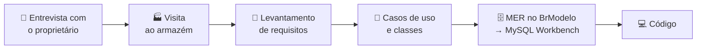

| Documento | O que mostra |
|-----------|--------------|
| [🗄️ Modelo do banco](docs/diagramas.md#1-modelo-do-banco-mer--modelo-lógico) | Tabelas, colunas, chaves, ligações e a lista para refazer o MER no BrModelo |
| [🧭 Casos de uso](docs/diagramas.md#2-diagrama-de-casos-de-uso) | O que o visitante, o cliente e o administrador podem fazer |
| [🧱 Classes](docs/diagramas.md#3-diagrama-de-classes) | Classes do domínio e como viram as camadas do back-end |
| [🔁 Ciclo do pedido](docs/diagramas.md#4-ciclo-de-vida-do-pedido) | Os status e o que cada mudança faz no estoque e nas vendas |
| [🧪 Roteiro de teste](docs/roteiro-de-teste.md) | Fluxo completo (visitante, cliente, admin, segurança e celular) com resultado esperado |
| [🎤 Roteiro de apresentação](docs/roteiro-de-apresentacao.md) | Ordem da demo, quem fala, tempo e perguntas prováveis |

<details>
<summary><b>📌 Requisitos principais (resumo)</b></summary>

<br>

| Tipo | Requisito |
|------|-----------|
| **RF01** | O visitante deve ver o catálogo sem login |
| **RF02** | O cliente deve montar um carrinho e enviar o pedido com data de retirada e observação |
| **RF03** | O cliente deve acompanhar e cancelar (se pendente) os próprios pedidos |
| **RF04** | O administrador deve mudar o status do pedido seguindo o fluxo |
| **RF05** | O estoque deve baixar ao confirmar e voltar ao cancelar um pedido confirmado |
| **RF06** | O administrador deve registrar entradas e saídas manuais com motivo |
| **RF07** | Entregar um pedido deve gerar a venda; a venda pode receber uma nota fiscal |
| **RF08** | O administrador deve ver tabelas de pedidos, vendas, notas, movimentações e usuários |
| **RNF01** | Senhas com hash; rotas protegidas por login e perfil no servidor |
| **RNF02** | Mensagens de erro em português e padrão único de resposta |
| **RNF03** | Funcionar em celular, tablet e computador |
| **RNF04** | Quantidade em estoque visível só para o administrador |

</details>

> [!NOTE]
> A emissão oficial da nota fiscal continua no **Emitte** (que a loja já usa, com clientes, produtos e transportadoras cadastrados). O sistema guarda o número, o status e o link do PDF, ligados à venda.

<div align="right"><a href="#topo">⬆️ voltar ao topo</a></div>

---

<a id="como-rodar"></a>

## 🚀 Como rodar o projeto

São **duas aplicações** que rodam ao mesmo tempo, cada uma no seu terminal: o **back-end** (API) e o **front-end** (site).

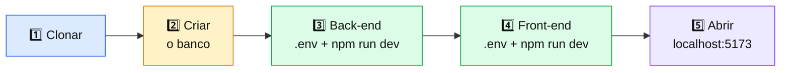

<a id="pre-requisitos"></a>

### 📋 Pré-requisitos

| Ferramenta | Versão | Para que serve | Como conferir |
|------------|--------|----------------|---------------|
| [Git](https://git-scm.com) | Recente | Clonar o repositório | `git --version` |
| [Node.js](https://nodejs.org) | LTS 22 ou superior | Rodar back-end e front-end | `node --version` |
| npm | Vem com o Node.js | Instalar as dependências | `npm --version` |
| [MySQL Server](https://dev.mysql.com/downloads/mysql/) | 8 ou superior | Banco de dados | `mysql --version` |
| [MySQL Workbench](https://dev.mysql.com/downloads/workbench/) | Recomendado | Rodar os scripts SQL com acentos certos | — |

### 1️⃣ Clonar o repositório

```bash
git clone https://github.com/Protagonistas-ADS/PI-2.git
cd PI-2
```

### 2️⃣ Criar o banco de dados

Scripts em `backend/src/database/`:

| Arquivo | O que faz | Quando rodar |
|---------|-----------|:------------:|
| `schema.sql` | Cria o banco `PI2` e as tabelas | ✅ Sempre |
| `seed.sql` | DML: dados de demonstração (8 usuários, 5 produtos — 3 ativos e 2 inativos —, 15 pedidos, 6 vendas, 5 notas, 27 movimentações) | ✅ Recomendado |
| `consultas.sql` | DQL: 7 consultas da loja (faturamento mensal, mais vendidos, melhores clientes, pedidos em andamento, estoque abaixo da média, conferência do estoque, notas com valor) | Opcional |
| `migracao-*.sql` (6 arquivos) | Atualizam bancos **antigos** sem apagar dados (remover cotação, imagens, status do pedido, foto padrão, movimentação/nota, remover atributos derivados) | Só se o banco é antigo |

**Pelo MySQL Workbench (recomendado):**

1. Abra a conexão com o seu MySQL.
2. **File → Open SQL Script** → `schema.sql` → clique no raio ⚡.
3. Repita com o `seed.sql`.

> [!WARNING]
> Para começar do zero, apague o banco antes com `DROP DATABASE IF EXISTS PI2;` e rode os dois scripts de novo. **Isso apaga tudo** o que estava no banco: faça um backup se precisar.

<details>
<summary><b>Pelo terminal (alternativa)</b></summary>

<br>

```bash
mysql -u SEU_USUARIO -p < backend/src/database/schema.sql
mysql -u SEU_USUARIO -p < backend/src/database/seed.sql
```

No Windows, os acentos podem sair errados pelo terminal: prefira o Workbench.

</details>

### 3️⃣ Configurar e rodar o back-end

```bash
cd backend
npm install
cp .env.example .env      # no Windows (PowerShell/CMD): copy .env.example .env
```

Preencha o `backend/.env`:

```env
PORT=3000
DB_HOST=localhost
DB_PORT=3306
DB_NAME=PI2
DB_USER=root
DB_PASS=sua_senha_do_mysql
JWT_SECRET=uma_chave_longa_e_aleatoria
CORS_ORIGIN=http://localhost:5173
```

| Variável | Descrição |
|----------|-----------|
| `PORT` | Porta da API |
| `DB_HOST` · `DB_PORT` · `DB_NAME` · `DB_USER` · `DB_PASS` | Conexão com o MySQL |
| `JWT_SECRET` | Chave que assina os tokens de login: longa, aleatória e **secreta** |
| `CORS_ORIGIN` | Endereço do site que pode chamar a API (vários: separe por vírgula) |

```bash
npm run dev
```

O terminal deve mostrar:

```text
Conexão com o banco estabelecida.
Servidor rodando em http://localhost:3000
Site autorizado (CORS): http://localhost:5173
```

### 4️⃣ Configurar e rodar o front-end

Em um **segundo terminal** (deixe o back-end rodando):

```bash
cd frontend
npm install
cp .env.example .env      # no Windows: copy .env.example .env
```

```env
VITE_API_URL=http://localhost:3000
```

```bash
npm run dev
```

> [!TIP]
> A porta do `VITE_API_URL` precisa ser a mesma do `PORT` do back-end. Mudou o `.env` do front? Reinicie o `npm run dev`.

### 5️⃣ Acessar o sistema

Abra **http://localhost:5173** no navegador.

| Perfil | E-mail | Senha |
|--------|--------|-------|
| 👑 Administrador | `admin@teste.com` | `Admin@123456` |
| 🛒 Cliente | `usuario@gmail.com` | `Cliente@123456` |

Os outros clientes do seed (ex.: `compras@rotasul.com.br`) usam a mesma senha. São contas **só para teste**: nunca use essas senhas em um servidor público. Todo cadastro novo pelo site entra como `cliente`.

<details>
<summary><b>👑 Criar um administrador (desenvolvimento)</b></summary>

<br>

Por segurança não existe cadastro de admin pela API. Crie a conta pelo site e promova no banco:

```sql
USE PI2;
UPDATE usuario SET perfil = 'administrador' WHERE email = 'seu-email@exemplo.com';
```

</details>

<details>
<summary><b>📜 Scripts disponíveis</b></summary>

<br>

| Pasta | Comando | O que faz |
|-------|---------|-----------|
| `backend` | `npm run dev` | API com recarga automática |
| `backend` | `npm run build` | Compila o TypeScript para `dist/` |
| `frontend` | `npm run dev` | Site em modo desenvolvimento |
| `frontend` | `npm run build` | Confere os tipos e gera o build de produção |
| `frontend` | `npm run typecheck` | Só confere os tipos |
| `frontend` | `npm run lint` | Analisa o código com o oxlint |
| `frontend` | `npm run preview` | Abre o build de produção |

</details>

<details>
<summary><b>🛟 Problemas comuns</b></summary>

<br>

| Sintoma | Causa provável | Solução |
|---------|----------------|---------|
| `Variáveis de ambiente faltando` | `.env` do back ausente ou incompleto | Confira as 5 variáveis `DB_*` |
| `JWT_SECRET não configurada` | Falta a variável | Adicione e reinicie |
| `Access denied for user` | Usuário/senha do MySQL errados | Revise `DB_USER` e `DB_PASS` |
| `Unknown database 'PI2'` | `schema.sql` não rodou | Rode o passo 2 |
| `ECONNREFUSED` | MySQL desligado | Inicie o serviço do MySQL |
| `EADDRINUSE` | Porta ocupada | Troque o `PORT` (e o `VITE_API_URL`) |
| `Network Error` no site | Back-end desligado ou URL errada | Ligue o back e confira o `.env` do front |
| Site barrado com `403` | Front em outra porta | Ajuste o `CORS_ORIGIN` do back |
| "Muitas tentativas de login" | 5 senhas erradas em 15 min | Espere 15 min ou reinicie o back-end |
| Volta sempre para o login | Token vencido (8 h) | Entre de novo |

</details>

<div align="right"><a href="#topo">⬆️ voltar ao topo</a></div>

---

<a id="pastas"></a>

## 📂 Estrutura de pastas

<details>
<summary><b>Ver a árvore do projeto</b></summary>

<br>

```text
PI-2/
├── 📁 backend/
│   ├── requests/            # exemplos de chamadas à API (.http)
│   ├── uploads/             # fotos dos produtos (servidas em /uploads)
│   └── src/
│       ├── configs/         # banco (pool), CORS e idioma do Zod
│       ├── controllers/     # recebem a requisição e respondem
│       ├── database/        # schema.sql (DDL), seed.sql (DML), consultas.sql (DQL) e migrações
│       ├── middlewares/     # login, perfil, validação, limite e erros
│       ├── repositories/    # consultas SQL
│       ├── routes/          # endereços da API
│       ├── schemas/         # validações Zod
│       ├── services/        # regras de negócio e transações
│       ├── types/ · utils/
│       ├── app.ts           # monta o Express (helmet, cors, rotas)
│       └── index.ts         # liga o servidor
├── 📁 docs/
│   ├── referencias/
│   │   └── catalogo-paletes.xlsx  # informações comerciais e técnicas dos produtos
│   ├── diagramas.md
│   ├── roteiro-de-teste.md
│   ├── roteiro-de-apresentacao.md
│   └── prints/                    # capturas de tela (atualização visual pendente)
├── 📁 frontend/
│   ├── public/              # favicon e Apple Touch Icon
│   └── src/
│       ├── assets/          # logos, fotos e imagens do projeto
│       ├── components/      # Navbar, Footer, cards, janelas, rotas protegidas...
│       ├── hooks/           # carrinho e ações de pedido do admin
│       ├── pages/           # Admin/, Cliente/ e Compartilhadas/
│       ├── routes/          # mapa das telas
│       ├── services/        # chamadas à API (Axios)
├── 📄 LICENSE
└── 📄 README.md
```

</details>

<div align="right"><a href="#topo">⬆️ voltar ao topo</a></div>

---

<a id="fluxo-trabalho"></a>

## 🤝 Fluxo de trabalho da equipe

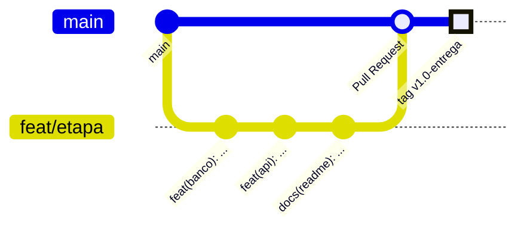

- 🌳 A **`main`** é a versão oficial (a que o professor avalia). A equipe não commita diretamente nela; a exceção é o GitHub Actions, que atualiza automaticamente as métricas do README.
- 🔀 Cada etapa em uma branch (`feat/...`, `fix/...`, `docs/...`) que entra por **Pull Request**.
- 🔄 Antes do PR: `git merge origin/main`, `npm run build` no back e no front e o checklist de teste.
- 🏷️ Versões marcadas com *tags*: `v1.0-entrega` (21/11) e `v1.0.1-entrega` (22/11).

**Commits no padrão [Conventional Commits](https://www.conventionalcommits.org/pt-br/)**: `tipo(escopo): descrição no imperativo`

| Tipo | Uso | Exemplo real |
|------|-----|--------------|
| ✨ `feat` | Função nova | `feat(catalogo): catálogo sem login, quantidade e carrinho no card` |
| 🐛 `fix` | Correção | `fix(auth): responder 401 para sessao expirada` |
| ♻️ `refactor` | Reorganizar sem mudar comportamento | `refactor(tipos): unificar o tipo dos itens da janela` |
| 🎨 `style` | Visual | `style(navbar): manter o menu em uma linha no tablet` |
| ⚡ `perf` | Desempenho | `perf(site): comprimir imagens` |
| 📝 `docs` | Documentação | `docs(roteiros): adicionar roteiro de teste` |
| 🔧 `chore` | Manutenção | `chore(frontend): trocar ESLint por oxlint` |

<details>
<summary><b>✅ Definição de Pronto (usada em cada etapa)</b></summary>

<br>

- [x] Faz o que foi pedido nos três níveis (banco, back-end, front-end), sem sobras de código antigo
- [x] Back-end e front-end compilam (`npm run build`) e sobem sem erro
- [x] Sem erros no console do navegador nem no terminal
- [x] Caminho feliz e pelo menos um caminho de erro testados
- [x] Segurança conferida (login/perfil, validação, nada sensível exposto)
- [x] Fluxos antigos continuam funcionando (regressão)
- [x] Seed, migração, README e contrato da API atualizados
- [x] Commits no padrão, branch atualizada com a `main` e PR descrito

</details>

<div align="right"><a href="#topo">⬆️ voltar ao topo</a></div>

---

<a id="status"></a>

## 📈 Status e roadmap

| Área | Progresso | Pronto |
|------|-----------|:------:|
| 🗄️ Banco de dados | `▰▰▰▰▰▰▰▰▰▰` 100% | 8 de 8 tabelas |
| ⚙️ Back-end | `▰▰▰▰▰▰▰▰▰▰` 100% | 30 de 30 rotas |
| 🖥️ Front-end | `▰▰▰▰▰▰▰▰▰▰` 100% | 15 de 15 telas |
| 📝 Documentação | `▰▰▰▰▰▰▰▰▰▰` 100% | README, diagramas, roteiros e prints |
| 🔭 Melhorias futuras | `▱▱▱▱▱▱▱▱▱▱` | [ver lista](#melhorias-futuras) |

<a id="cronograma"></a>

### 🗓️ Cronograma

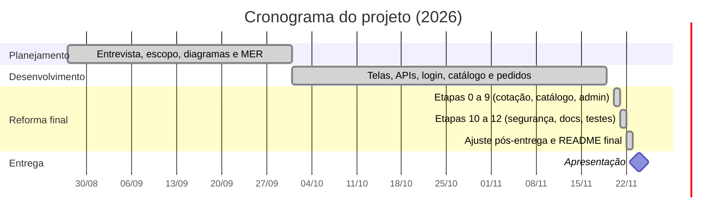

| Período | O que foi feito |
|---------|-----------------|
| 27/08 a 01/10 | Entrevista, visita ao armazém, escopo, casos de uso, classes, protótipo e MER |
| 03/09 a 19/11 | Desenvolvimento pela equipe: telas, componentes, rotas de usuário, produto, pedido, cotação, estoque, venda e nota |
| 20/11 | Reforma: remover cotação, rodapé, cadastro, catálogo público, carrinho, landing, painel e tabelas do admin |
| 21/11 | Segurança, qualidade, seed, documentação, teste completo e versão `v1.0-entrega` |
| 22/11 | Estoque escondido do cliente (`v1.0.1-entrega`), e README final |
| **24/11** | **🏁 Apresentação e entrega** |

<div align="right"><a href="#topo">⬆️ voltar ao topo</a></div>

---

<a id="melhorias-futuras"></a>

## 🔭 Melhorias futuras

Levantadas durante o projeto e deixadas **de propósito** fora desta entrega, para priorizar o que o cliente e o professor pediram:

| # | Melhoria | Por que importa | Esforço |
|:-:|----------|-----------------|:-------:|
| L18 | Telefone do cliente no cadastro + texto de privacidade (**LGPD**) | Facilita o contato e deixa claro como os dados são usados | médio |
| L19 | Tela de produtos no painel com **upload de foto** (`multer`) | O próprio dono troca fotos e preços sem mexer na API | médio |
| L20 | Índices extras e regras `CHECK` no banco | Consultas mais rápidas e uma segunda barreira contra dados inválidos | baixo |
| L21 | **Testes automatizados** (Vitest) | Conferem sozinhos as regras de pedido, estoque e nota a cada mudança | alto |
| — | *Code splitting* no front-end | Primeira abertura do site mais rápida | baixo |
| — | **Publicar** (domínio, HTTPS, `trust proxy`, `JWT_SECRET` forte) | Hoje roda localmente | médio |
| — | Fotos institucionais da landing page e confirmação do horário de sábado | Dependem do material e da confirmação do cliente | baixo |
| — | Avisar o cliente por WhatsApp/e-mail quando o pedido mudar de status | Menos ligações para a loja | médio |
| — | Gráficos de vendas por mês e produto mais vendido | Ajuda a decidir compras | médio |

**💡 Ideias para versões seguintes:** gerenciamento de compras de fornecedores, frete e entregas, perfil de colaborador (RH) e integração direta com o Emitte.

<div align="right"><a href="#topo">⬆️ voltar ao topo</a></div>

---

<a id="equipe"></a>

## 👥 Equipe

<div align="center">

**Protagonistas ADS** · FATEC · Análise e Desenvolvimento de Sistemas

<table>
<tr>
<td align="center" width="20%">
<br>
<b>Yuri Tavares</b><br>
<sub>⚙️ Back-end<br>📦 Módulo de estoque<br>🔧 Reforma final: banco, back-end, front-end e documentação</sub>
</td>
<td align="center" width="20%">
<br>
<b>Antonio Miguel Souza Marques</b><br>
<sub>⚙️ Back-end<br>📨 Rotas de cotação (versão inicial)<br>🔐 Apresenta back-end e segurança</sub>
</td>
<td align="center" width="20%">
<br>
<b>Gustavo Henrique Teles</b><br>
<sub>🖥️ Front-end · 🗄️ Banco<br>🛒 Carrinho, pedido, venda e nota fiscal</sub>
</td>
<td align="center" width="20%">
<br>
<b>Davi Aurélio de Pontes Lopes</b><br>
<sub>🖥️ Front-end · 🗄️ Banco<br>👤 Rotas de usuário, login e estrutura inicial</sub>
</td>
<td align="center" width="20%">
<br>
<b>Henrique Domingues</b><br>
<sub>🗄️ Banco de dados<br>📦 Rotas de produto</sub>
</td>
</tr>
</table>

</div>

| Área | Integrantes |
|------|-------------|
| ⚙️ Back-end | Yuri Tavares, Antonio Miguel Souza Marques |
| 🖥️ Front-end | Davi Aurélio de Pontes Lopes, Gustavo Henrique Teles |
| 🗄️ Banco de dados | Henrique Domingues, Gustavo Henrique Teles, Davi Aurélio de Pontes Lopes |

<div align="right"><a href="#topo">⬆️ voltar ao topo</a></div>

---

<a id="licenca"></a>

## 📄 Licença

Distribuído sob a licença **MIT**. Veja o arquivo [`LICENSE`](LICENSE).

<div align="center">

<br>

Feito com 💛 pela equipe **Protagonistas ADS** para a **S Ferraretto** · Salto-SP

⭐ Se o projeto te interessou, deixe uma estrela no repositório!


</div>
