<a id="topo"></a>

<div align="center">

# 🪵 PI-2 · Catálogo e Venda de Paletes

### Divulgue, venda e controle o estoque de paletes de madeira em um só lugar

Projeto Integrador · FATEC · Análise e Desenvolvimento de Sistemas

<br>


<br>

[**🎯 Sobre**](#-sobre-o-projeto) ·
[**✨ Funcionalidades**](#-funcionalidades) ·
[**🏗️ Arquitetura**](#️-arquitetura) ·
[**🔌 API**](#-api-back-end) ·
[**📸 Telas**](#️-telas-front-end) ·
[**🔐 Segurança**](#-segurança-da-informação) ·
[**🚀 Como rodar**](#-como-rodar-o-projeto) ·
[**📐 Diagramas**](docs/diagramas.md) ·
[**🧪 Roteiros**](docs/roteiro-de-teste.md) ·
[**🔭 Melhorias futuras**](#-melhorias-futuras) ·
[**👥 Equipe**](#-equipe)

</div>

---

## 📑 Sumário

<details>
<summary><b>Clique para expandir o sumário</b></summary>

<br>

- [Sobre o projeto](#-sobre-o-projeto)
- [O problema que resolvemos](#-o-problema-que-resolvemos)
- [Funcionalidades](#-funcionalidades)
- [Arquitetura](#️-arquitetura)
- [Tecnologias](#️-tecnologias)
- [Banco de dados](#️-banco-de-dados)
- [API (back-end)](#-api-back-end)
- [Telas (front-end)](#️-telas-front-end)
- [Segurança da informação](#-segurança-da-informação)
- [Engenharia de requisitos e diagramas](#-engenharia-de-requisitos-e-diagramas)
- [Como rodar o projeto](#-como-rodar-o-projeto)
- [Estrutura de pastas](#-estrutura-de-pastas)
- [Fluxo de trabalho da equipe](#-fluxo-de-trabalho-da-equipe)
- [Status e roadmap](#-status-e-roadmap)
- [Melhorias futuras](#-melhorias-futuras)
- [Equipe](#-equipe)
- [Licença](#-licença)

</details>

---

## 🎯 Sobre o projeto

O **PI-2** é uma aplicação web desenvolvida para a **S Ferraretto**, empresa de Salto-SP que comercializa paletes de madeira. O sistema reúne em um só lugar:

| | |
|---|---|
| 🌐 **Divulgação** | Landing page voltada para contato e catálogo de produtos com carrinho |
| 🔄 **Fluxo comercial** | Pedido → venda → nota fiscal |
| 📦 **Estoque** | Saldo por produto e histórico de entradas e saídas |

> [!NOTE]
> O projeto nasceu de uma entrevista com o cliente e de uma visita ao armazém, para entender na prática como a operação funciona hoje.

<div align="right"><a href="#topo">⬆️ voltar ao topo</a></div>

---

## 🧩 O problema que resolvemos

Na entrevista com o cliente, identificamos três dores principais:

| # | Problema | Como o sistema ajuda |
|:-:|----------|----------------------|
| 1️⃣ | **Falta de divulgação** | Landing page e catálogo online, acessíveis a qualquer cliente |
| 2️⃣ | **Falta de gerenciamento de estoque** | Saldo por produto e histórico de movimentações (entrada e saída) |
| 3️⃣ | **Falta de canal de vendas** | Clientes fazem pedidos direto pelo site |

<div align="right"><a href="#topo">⬆️ voltar ao topo</a></div>

---

## ✨ Funcionalidades

<table>
<tr>
<td width="50%" valign="top">

### 👤 Cliente

- 🔑 Cadastro, login e edição de perfil
- 🛍️ Catálogo de paletes aberto (sem login), com quantidade e carrinho direto no card
- 🛒 Página do carrinho (`/carrinho`) com data de retirada e observação
- 📝 Realização de **pedidos** a partir do carrinho (estoque conferido na hora, sem mostrar a quantidade: o cliente vê só "Disponível" ou "Esgotado")
- 🔎 Acompanhamento do status dos pedidos (histórico completo)
- ❌ Cancelamento de pedidos enquanto aguardam confirmação

</td>
<td width="50%" valign="top">

### 🛠️ Administrador

- 🧭 Painel próprio (`/admin`) com menu lateral — o admin cai nele ao fazer login
- 📊 Dashboard: pedidos pendentes, a retirar hoje, estoque baixo e vendas do mês
- 📋 Gerenciamento de pedidos: confirmar, marcar pronto, entregar ou cancelar (no dashboard e na tabela de pedidos)
- 🔎 Tabela de pedidos completa: busca por nº/cliente/e-mail, filtro por status e período, ordenação e soma dos valores
- 👥 Tabela de usuários: busca, filtro por perfil, nº de pedidos e total comprado de cada cliente
- 📦 Movimentações de estoque: histórico com responsável, motivo e pedido de origem + entrada/saída manual com motivo obrigatório
- 💰 Tabela de vendas: total do período, média por venda, itens e botão "Emitir nota" para vendas sem nota
- 🧾 Tabela de notas fiscais: número, status (emitida/cancelada), link do PDF no Emitte, editar link e cancelar
- 👤 Perfil do administrador (nome e senha)
- 📦 Gerenciamento de produtos pela API: cadastrar, editar e ativar/desativar (a tela própria está nas [melhorias futuras](#-melhorias-futuras))

</td>
</tr>
</table>

### 🔄 Fluxo comercial

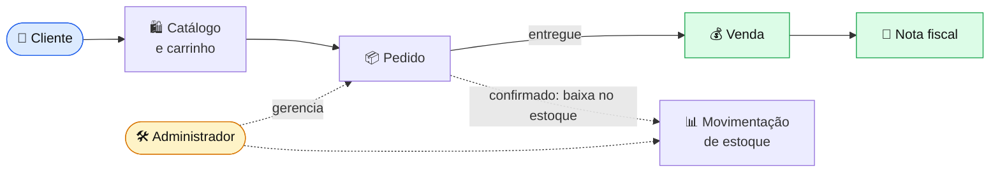

<details>
<summary><b>🔁 Ciclo de vida de um pedido</b></summary>

<br>

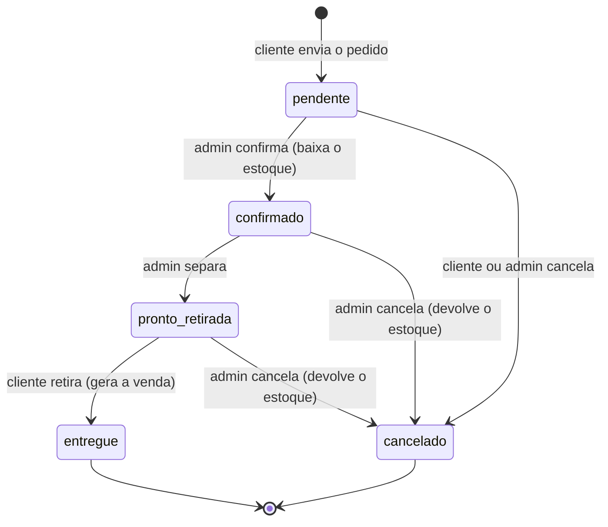

O cliente só cancela pelo site enquanto o pedido está **pendente**. Depois de confirmado, só o administrador cancela.

</details>

> [!NOTE]
> O andamento de cada item está na seção [Status e roadmap](#-status-e-roadmap).

<div align="right"><a href="#topo">⬆️ voltar ao topo</a></div>

---

## 🏗️ Arquitetura


O back-end segue uma arquitetura em camadas, em que cada camada tem uma única responsabilidade:

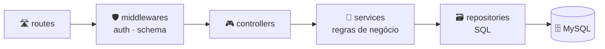

| Camada | Responsabilidade |
|--------|------------------|
| `routes` | Define os endpoints e quais middlewares cada um usa |
| `middlewares` | Autenticação (JWT), autorização por perfil, validação (Zod) e tratamento de erros |
| `controllers` | Recebe a requisição e devolve a resposta HTTP |
| `services` | Regras de negócio e validações |
| `repositories` | Consultas SQL ao banco |
| `schemas` | Esquemas de validação dos dados de entrada (Zod) |

<details>
<summary><b>🔑 Como funciona o login (sequência)</b></summary>

<br>

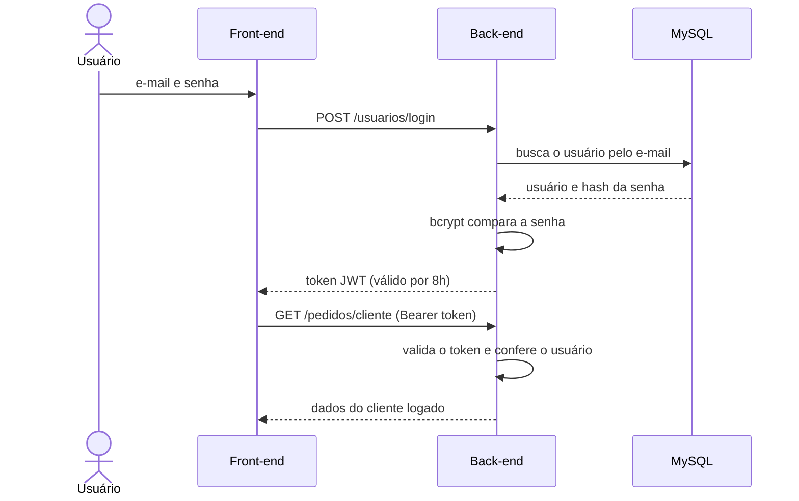

</details>

<div align="right"><a href="#topo">⬆️ voltar ao topo</a></div>

---

## 🛠️ Tecnologias


<br>


<br>


<table>
<tr>
<td width="50%" valign="top">

**🖥️ Front-end**

| Tecnologia | Uso |
|------------|-----|
| React 19 + TypeScript | Interface |
| Vite | Build e servidor de desenvolvimento |
| React Router | Rotas públicas e protegidas |
| Styled Components | Estilização |
| Axios | Comunicação com a API |
| SweetAlert2 e React Toastify | Alertas e notificações |
| React Icons | Ícones |
| oxlint | Análise do código `.ts/.tsx` (lint) |

</td>
<td width="50%" valign="top">

**⚙️ Back-end**

| Tecnologia | Uso |
|------------|-----|
| Node.js + Express 5 + TypeScript | Servidor da API |
| MySQL + mysql2 | Banco de dados |
| JSON Web Token | Autenticação |
| bcrypt | Criptografia de senhas |
| Zod | Validação de dados |
| dotenv e cors | Variáveis de ambiente e CORS (só o endereço do site) |
| helmet | Cabeçalhos de segurança em todas as respostas |
| express-rate-limit | Limite de tentativas de login |

</td>
</tr>
</table>

**🧰 Ferramentas:** VS Code · MySQL Workbench · BrModelo · Git e GitHub

<div align="right"><a href="#topo">⬆️ voltar ao topo</a></div>

---

## 🗄️ Banco de dados

O banco se chama `PI2`. O script completo está em [`backend/src/database/schema.sql`](backend/src/database/schema.sql) e há dados de teste em [`seed.sql`](backend/src/database/seed.sql).

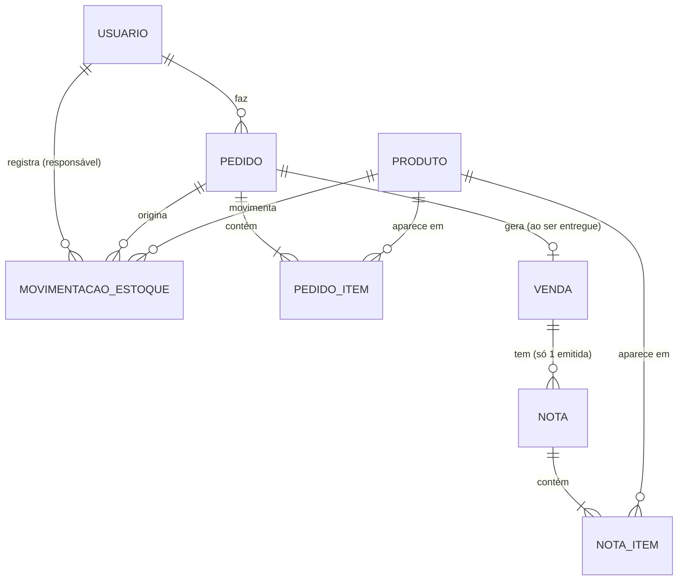

> O modelo completo, com todas as colunas e tipos, está em [**docs/diagramas.md**](docs/diagramas.md#1-modelo-do-banco-mer--modelo-lógico).

<details>
<summary><b>📚 Dicionário das tabelas</b></summary>

<br>

| Tabela | Descrição |
|--------|-----------|
| `usuario` | Clientes e administradores (`perfil`) |
| `produto` | Paletes do catálogo, com preço e saldo em estoque |
| `pedido` / `pedido_item` | Pedidos e seus itens, com data prevista de retirada e observação. Status: pendente, confirmado, pronto_retirada, entregue, cancelado |
| `venda` | Venda gerada a partir de um pedido |
| `nota` / `nota_item` | Nota fiscal da venda e seus itens, com `status` (emitida/cancelada) e `link_pdf` (PDF no Emitte). Cada venda tem no máximo uma nota emitida; se ela for cancelada, dá para registrar outra |
| `movimentacao_estoque` | Histórico de entradas e saídas por produto, com `usuario_id` (responsável), `motivo` e `pedido_id` (pedido de origem; manual = vazio) |
| `telefone` / `endereco` | Reservadas para uma versão futura (telefone e endereço do cliente); ainda não são usadas pelo sistema |

</details>

<div align="right"><a href="#topo">⬆️ voltar ao topo</a></div>

---

## 🔌 API (back-end)

Rotas marcadas com 🔒 exigem o header `Authorization: Bearer <token>`.

**Legenda:** 🟢 `GET` · 🔵 `POST` · 🟣 `PUT` · 🟠 `PATCH`

<details open>
<summary><b>👤 Usuários</b></summary>

<br>

| Método | Rota | Descrição | Auth |
|:------:|------|-----------|:----:|
| 🔵 `POST` | `/usuarios` | Cadastro de usuário | |
| 🔵 `POST` | `/usuarios/login` | Login (retorna o token JWT). Depois de 5 tentativas erradas em 15 min → `429` | |
| 🟢 `GET` | `/usuarios/logado` | Dados do usuário logado `{ usuario: { id, nome, email, perfil, criado_em } }` | 🔒 |
| 🟠 `PATCH` | `/usuarios` | Atualizar nome e senha | 🔒 |

</details>

<details open>
<summary><b>📦 Produtos</b></summary>

<br>

| Método | Rota | Descrição | Auth |
|:------:|------|-----------|:----:|
| 🟢 `GET` | `/produtos` | Catálogo: lista os produtos **ativos** com `disponivel: true/false` (sem a quantidade em estoque) | 🌐 |
| 🟢 `GET` | `/produtos/:id` | Detalhes de um produto ativo, com `disponivel` e sem a quantidade (`404` se não existir ou estiver desativado) | 🌐 |
| 🟢 `GET` | `/produtos/todos` | Lista todos os produtos, inclusive os desativados, com `quantidade_estoque` | 🔒 admin |
| 🔵 `POST` | `/produtos` | Cadastrar produto `{ nome, descricao, preco, quantidade, imagem? }` → `201 { id }` | 🔒 admin |
| 🟣 `PUT` | `/produtos/:id` | Editar produto (mesmo corpo do cadastro) → `204` | 🔒 admin |
| 🟠 `PATCH` | `/produtos/:id/ativo` | Ativar/desativar `{ "ativo": false }` → `204` | 🔒 admin |

A quantidade em estoque é informação só do administrador: as rotas públicas devolvem apenas `disponivel` (estoque maior que zero). Produtos não são apagados: desativar tira o produto do catálogo, mas preserva pedidos, vendas e notas antigos. O campo `imagem` guarda só o nome do arquivo da pasta `backend/uploads` (servida em `/uploads/<arquivo>`).

</details>

<details open>
<summary><b>🛒 Pedidos</b></summary>

<br>

| Método | Rota | Descrição | Auth |
|:------:|------|-----------|:----:|
| 🔵 `POST` | `/pedidos` | Criar pedido → `201 { pedidoId }` | 🔒 cliente |
| 🟢 `GET` | `/pedidos/cliente` | Pedidos do cliente logado (todos os status, com `valor_total`) | 🔒 cliente |
| 🟢 `GET` | `/pedidos/itens/:id` | Itens de um pedido do próprio cliente | 🔒 cliente |
| 🟠 `PATCH` | `/pedidos/cancelar/:id` | Cancelar pedido (só `pendente`) → `204` | 🔒 cliente |
| 🟢 `GET` | `/pedidos` | Todos os pedidos, com nome e e-mail do cliente | 🔒 admin |
| 🟢 `GET` | `/pedidos/:id/itens` | Itens de qualquer pedido → `{ produtos: [...] }` (`404` se não existir) | 🔒 admin |
| 🟠 `PATCH` | `/pedidos/:id/status` | Mudar status `{ "status": "confirmado" }` → `200 { id, status_anterior, status }` | 🔒 admin |

Corpo de `POST /pedidos`:

```json
{
  "itens": [{ "produto_id": 1, "quantidade": 10 }],
  "previsao_busca": "2026-11-25",
  "observacao": "Vou buscar com caminhão no fim da tarde."
}
```

- `previsao_busca` (opcional): data `AAAA-MM-DD`, de hoje até 60 dias. `observacao` (opcional): até 500 caracteres.
- Estoque insuficiente → `409` ("No momento não temos essa quantidade de ..." com o nome do produto, sem informar o saldo). Produto desativado → `409` com o nome do produto. Produto inexistente → `404`.
- Status: `pendente → confirmado → pronto_retirada → entregue`, ou `cancelado`. Mudança fora dessa ordem → `409`.
- **Confirmar** baixa o estoque (saída); **cancelar** um pedido confirmado devolve (entrada); **entregar** registra a venda. Tudo na mesma transação.

</details>

<details open>
<summary><b>🧭 Painel do administrador</b></summary>

<br>

| Método | Rota | Descrição | Auth |
|:------:|------|-----------|:----:|
| 🟢 `GET` | `/admin/resumo` | Números do dashboard | 🔒 admin |
| 🟢 `GET` | `/admin/usuarios` | Todos os usuários (sem senha), do cadastro mais novo ao mais antigo → `{ usuarios: [...] }` | 🔒 admin |

Resposta de `GET /admin/usuarios`:

```json
{
  "usuarios": [
    {
      "id": 1,
      "nome": "Cliente Teste",
      "email": "usuario@gmail.com",
      "perfil": "cliente",
      "criado_em": "2026-11-20T13:00:00.000Z",
      "total_pedidos": 3,
      "total_comprado": 1050
    }
  ]
}
```

- `total_pedidos`: todos os pedidos do usuário (qualquer status).
- `total_comprado`: soma das vendas do usuário (pedidos entregues).
- A senha nunca sai do banco. Sem token → `401`; cliente → `403`.

Resposta de `GET /admin/resumo`:

```json
{
  "pendentes": 1,
  "retirar_hoje": 1,
  "limite_estoque_baixo": 10,
  "estoque_baixo": [{ "id": 4, "nome": "Palete plástico", "quantidade_estoque": 7 }],
  "vendas_mes": { "quantidade": 2, "valor_total": 5700 }
}
```

- `retirar_hoje`: pedidos `pronto_retirada` + pedidos `confirmado` com retirada marcada para hoje.
- `estoque_baixo`: produtos ativos com `limite_estoque_baixo` (10) unidades ou menos, do menor para o maior.
- `vendas_mes`: vendas registradas no mês atual (pedidos entregues).

</details>

<details open>
<summary><b>💰 Vendas</b> (somente administrador)</summary>

<br>

| Método | Rota | Descrição | Auth |
|:------:|------|-----------|:----:|
| 🟢 `GET` | `/vendas` | Todas as vendas, da mais nova para a mais antiga → `{ vendas: [...] }` | 🔒 admin |
| 🔵 `POST` | `/vendas` | Registrar a venda de um pedido `entregue` que ficou sem venda `{ "pedido_id": 3 }` | 🔒 admin |

Pedidos marcados como entregues pelo sistema já ganham a venda sozinhos; o `POST` serve para pedidos antigos. Não mexe no estoque (ele baixou na confirmação).

Cada venda de `GET /vendas` traz: `id`, `pedido_id`, `valor_total`, `data_venda`, `cliente_id`, `cliente_nome`, `cliente_email`, `quantidade_total` e a nota **emitida** (`nota_id`, `nota_numero`; `null` = sem nota).

</details>

<details open>
<summary><b>🧾 Notas fiscais</b> (somente administrador)</summary>

<br>

A nota é emitida no **Emitte**; o sistema guarda o número, o status e o link do PDF.

| Método | Rota | Descrição | Auth |
|:------:|------|-----------|:----:|
| 🟢 `GET` | `/notas` | Todas as notas (com venda, pedido e cliente) → `{ notas: [...] }` | 🔒 admin |
| 🔵 `POST` | `/notas` | Registrar a nota de uma venda → `201` | 🔒 admin |
| 🟠 `PATCH` | `/notas/:id/link` | Trocar ou apagar o link do PDF `{ "link_pdf": "https://..." \| null }` | 🔒 admin |
| 🟠 `PATCH` | `/notas/:id/cancelar` | Cancelar a nota (fica no histórico) | 🔒 admin |

Corpo de `POST /notas`:

```json
{
  "venda_id": 2,
  "numero": "NF-000002",
  "natureza_operacao": "Venda de mercadoria",
  "link_pdf": "https://app.emitte.com.br/nfe/NF-000002.pdf"
}
```

- `numero`: obrigatório, até 30 caracteres, só letras, números, `.`, `/` e `-`; não pode repetir (nem de nota cancelada) → `409`.
- `natureza_operacao`: opcional (vazio = "Venda de mercadoria").
- `link_pdf`: opcional; só aceita `http://` ou `https://` (bloqueia `javascript:` e afins) → `400`.
- Venda que já tem nota emitida → `409`; venda inexistente → `404`.
- Cancelar nota já cancelada ou mudar o link de nota cancelada → `409`. Depois de cancelar, a venda volta a ficar "sem nota" e aceita uma nota nova.

</details>

<details open>
<summary><b>📊 Estoque</b> (somente administrador)</summary>

<br>

| Método | Rota | Descrição | Auth |
|:------:|------|-----------|:----:|
| 🟢 `GET` | `/estoque` | Saldo atual de todos os produtos | 🔒 admin |
| 🟢 `GET` | `/estoque/movimentacoes` | Histórico de entradas e saídas (com responsável, motivo e pedido) | 🔒 admin |
| 🟢 `GET` | `/estoque/movimentacoes/:id` | Saldo e histórico de um produto (`:id` inválido → `400`, inexistente → `404`) | 🔒 admin |
| 🔵 `POST` | `/estoque/entrada` | Registrar entrada `{ produto_id, quantidade, motivo }` | 🔒 admin |
| 🔵 `POST` | `/estoque/saida` | Registrar saída manual `{ produto_id, quantidade, motivo }` | 🔒 admin |

Cada entrada ou saída atualiza o saldo do produto e grava o histórico na mesma transação. O `motivo` é obrigatório (3 a 255 caracteres) e o responsável é o administrador logado (vem do token, não do corpo). Saída maior que o saldo retorna `409`.

Cada movimentação do histórico traz: `id`, `produto_id`, `produto_nome`, `tipo` (`entrada`/`saida`), `quantidade`, `motivo`, `usuario_id`, `responsavel_nome`, `pedido_id` (`null` = manual) e `data_mov`. Confirmar um pedido gera as saídas com o motivo "Confirmação do pedido nº X"; cancelar um pedido confirmado gera as entradas "Cancelamento do pedido nº X (estoque devolvido)".

</details>

<details>
<summary><b>⚠️ Formato dos erros</b></summary>

<br>

Erros seguem o formato `{ "erro": "mensagem" }`, sempre em português. Erros de validação (Zod) retornam `400` com os detalhes em `detalhes`. Os códigos usados: `400` dados inválidos (inclusive JSON mal formado), `401` sem login (ou sessão expirada/token inválido), `403` sem permissão, `404` não encontrado (inclusive rota inexistente), `409` conflito com a regra de negócio (ex.: estoque insuficiente), `500` erro interno.

```json
{
  "erro": "Dados inválidos",
  "detalhes": [ ... ]
}
```

</details>

<div align="right"><a href="#topo">⬆️ voltar ao topo</a></div>

---

## 🖥️ Telas (front-end)

| Rota | Tela | Acesso |
|------|------|:------:|
| `/` | Tela inicial (landing page com contatos) | 🌐 Pública |
| `/cadastro` | Cadastro de usuário | 🌐 Pública |
| `/login` | Login | 🌐 Pública |
| `/catalogo` | Catálogo de produtos e carrinho (login só para finalizar o pedido) | 🌐 Pública |
| `/carrinho` | Carrinho: revisar itens, data de retirada, observação e enviar o pedido | 🌐 Pública (envio exige login de cliente) |
| `/perfil` | Perfil do cliente | 🔒 Cliente |
| `/clientePedidos` | Meus Pedidos (acompanhamento dos pedidos) | 🔒 Cliente |
| `/admin` | Dashboard: indicadores e pedidos em andamento com botões de status (+ link "Ver todos os pedidos") | 🔒 Admin |
| `/admin/pedidos` | Tabela de todos os pedidos: busca, status, período, ordenação, itens e botões de status | 🔒 Admin |
| `/admin/usuarios` | Tabela de usuários: busca, perfil, ordenação, nº de pedidos e total comprado | 🔒 Admin |
| `/admin/movimentacoes` | Movimentações de estoque: registrar entrada/saída manual e histórico com busca, produto, tipo e período | 🔒 Admin |
| `/admin/vendas` | Tabela de vendas: busca, período, com/sem nota, total e média, itens e "Emitir nota" | 🔒 Admin |
| `/admin/notas` | Tabela de notas fiscais: busca, status, período, link do PDF, editar link e cancelar | 🔒 Admin |
| `/admin/perfil` | Perfil do administrador | 🔒 Admin |
| qualquer outro endereço | Página 404 "Página não encontrada" com botões para voltar (o painel tem a sua própria em `/admin/...`) | 🌐 Pública |

### 📸 Prints

Capturas feitas com os dados de demonstração do `seed.sql` (todas as imagens estão em [`docs/prints/`](docs/prints)).

<table>
<tr>
<td width="50%" align="center">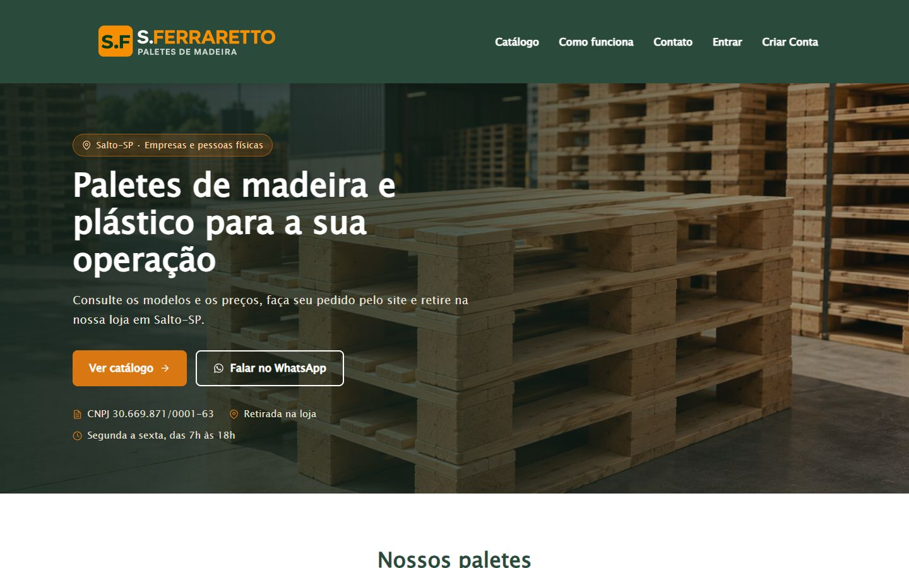<br><sub><b>Tela inicial</b>: CNPJ, horário, WhatsApp e catálogo</sub></td>
<td width="50%" align="center">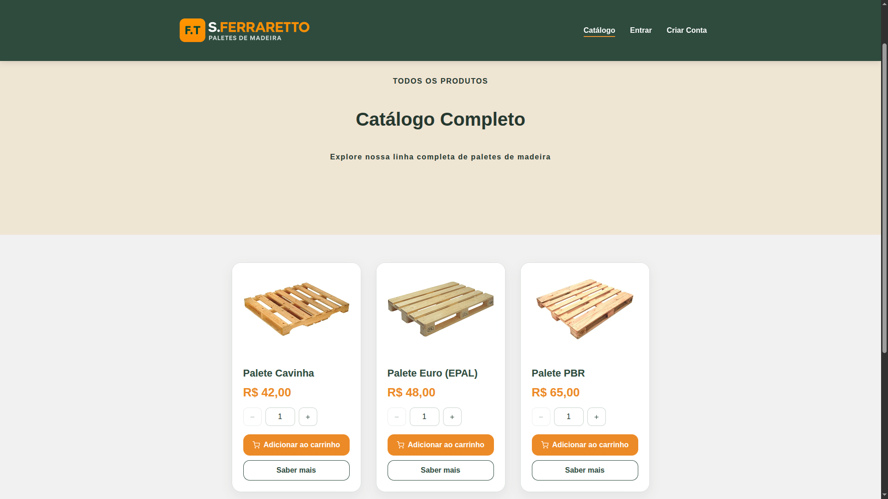<br><sub><b>Catálogo aberto</b>: quantidade e carrinho direto no card</sub></td>
</tr>
<tr>
<td align="center">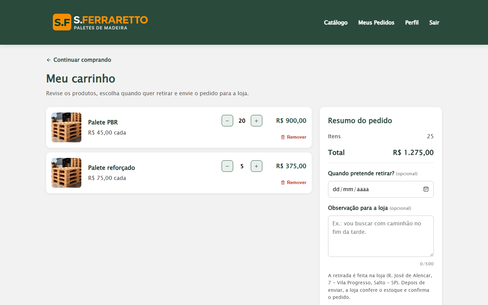<br><sub><b>Carrinho</b>: data de retirada e observação</sub></td>
<td align="center">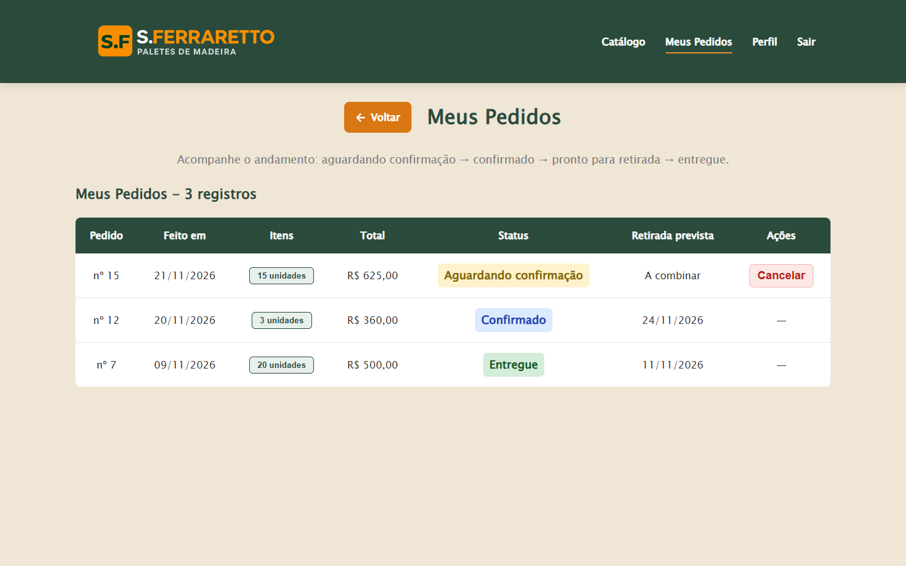<br><sub><b>Meus Pedidos</b>: histórico com status</sub></td>
</tr>
<tr>
<td align="center">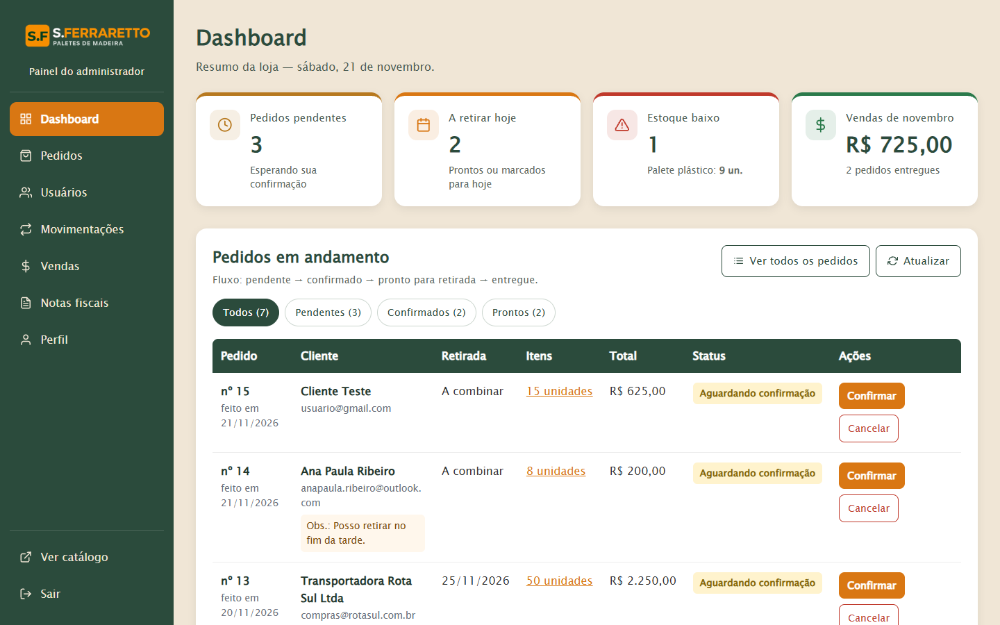<br><sub><b>Dashboard</b>: indicadores e pedidos em andamento</sub></td>
<td align="center"><br><sub><b>Tabela de pedidos</b>: busca, filtros e status</sub></td>
</tr>
<tr>
<td align="center"><br><sub><b>Movimentações</b>: quem, quando, por quê e de qual pedido</sub></td>
<td align="center">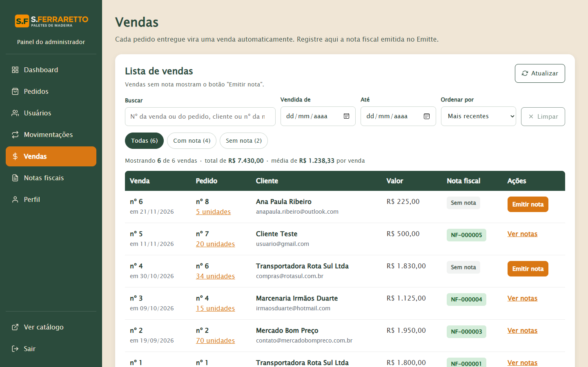<br><sub><b>Vendas</b>: total, média e "Emitir nota"</sub></td>
</tr>
<tr>
<td align="center"><br><sub><b>Notas fiscais</b>: status e link do PDF no Emitte</sub></td>
<td align="center">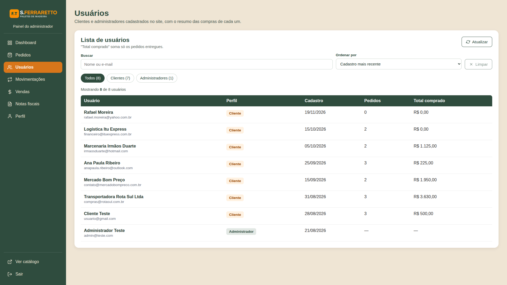<br><sub><b>Usuários</b>: perfil, nº de pedidos e total comprado</sub></td>
</tr>
</table>

<details>
<summary><b>Mais prints (login e celular)</b></summary>

<br>

<p align="center">

&nbsp;

</p>

</details>

### 🔐 Quem pode abrir cada tela

Quem decide o acesso é o servidor: o front-end confere o perfil em `GET /usuarios/logado` e só ajuda na navegação. Admin que abre tela de cliente vai para `/admin`; cliente que abre `/admin` volta para o catálogo com o aviso "Área restrita"; sem login vai para `/login` e, depois de entrar, volta para a tela que tentou abrir. Se o servidor estiver fora do ar, a sessão não é apagada: a tela mostra o aviso com o botão "Tentar de novo". Mesmo que alguém force o caminho, a API responde `401`/`403`.

<div align="right"><a href="#topo">⬆️ voltar ao topo</a></div>

---

## 🔐 Segurança da informação

<details open>
<summary><b>✅ O que já está implementado</b></summary>

<br>

| Área | Prática adotada |
|------|-----------------|
| 🔑 **Senhas** | Armazenadas apenas como hash **bcrypt** (10 rounds), nunca em texto puro |
| 🎫 **Autenticação** | **JWT** com expiração de 8 horas, validado a cada requisição; o usuário é conferido no banco, então um usuário removido perde o acesso |
| 🛂 **Autorização** | Perfis `cliente` e `administrador`, com middleware próprio para rotas de admin |
| 💉 **Injeção de SQL** | Todas as consultas usam *prepared statements* (`?`) do mysql2 |
| 🧹 **Validação de entrada** | Todo corpo de requisição passa por esquemas **Zod** antes de chegar ao controller |
| 👥 **Cadastro seguro** | O perfil de quem se cadastra é sempre `cliente`, definido no servidor e não pelo cliente da API |
| 🧱 **Isolamento de dados** | Pedidos são sempre filtrados pelo `cliente_id` do token, então um cliente não acessa dados de outro |
| 🚪 **Login** | Mensagem genérica ("e-mail ou senha inválidos"), sem revelar qual dos dois está errado |
| 🙈 **Respostas** | O hash da senha nunca é devolvido pela API; a quantidade em estoque só aparece nas rotas de admin (o catálogo recebe só `disponivel`); erros inesperados retornam mensagem genérica (`500`) |
| 🗝️ **Segredos** | Credenciais ficam no `.env`, que está no `.gitignore`; o repositório traz apenas o `.env.example` |
| 🌐 **CORS** | Só o endereço do site (`CORS_ORIGIN` no `.env`) pode chamar a API pelo navegador; outro site recebe `403` |
| 🛑 **Força bruta** | Depois de **5 tentativas de login erradas em 15 minutos**, o mesmo IP recebe `429` ("Muitas tentativas de login...") até a janela acabar; logins certos não contam (`express-rate-limit`) |
| 🪖 **Cabeçalhos** | **Helmet** em todas as respostas (ex.: impede abrir a API dentro de outro site e esconde o `X-Powered-By: Express`); só as fotos de `/uploads` são liberadas para o site |
| 🔗 **Integridade** | Chaves estrangeiras e restrições `UNIQUE`/`NOT NULL` no banco |

</details>

<details open>
<summary><b>🛣️ Melhorias previstas</b></summary>

<br>

- [x] Restringir o **CORS** ao endereço do front-end (em produção, colocar o domínio real em `CORS_ORIGIN`)
- [x] Adicionar **rate limiting** no login e cabeçalhos de segurança com **Helmet**
- [ ] Ao publicar atrás de um proxy (ex.: Render, Nginx), configurar o `trust proxy` do Express para o limite de login enxergar o IP real
- [x] Aplicar o middleware de administrador nas rotas de gestão (produtos, estoque, notas e vendas)
- [ ] Fortalecer a política de senhas (tamanho mínimo e complexidade)
- [ ] Servir tudo por **HTTPS** e usar um `JWT_SECRET` longo e aleatório
- [ ] Avaliar o armazenamento do token (hoje em `localStorage`) e criar um usuário de banco com privilégios mínimos
- [ ] Adequação à **LGPD**: coletar apenas os dados necessários e definir regras de retenção

</details>

<div align="right"><a href="#topo">⬆️ voltar ao topo</a></div>

---

## 📋 Engenharia de requisitos e diagramas

Antes de codificar, a equipe levantou os requisitos com o cliente:

- 🎤 Entrevista com o proprietário e **visita ao armazém** para entender a operação
- 📄 Relatório de levantamento de requisitos
- 🧭 Diagrama de casos de uso
- 🧱 Diagrama de classes
- 🗄️ Modelagem do banco (MER no BrModelo, depois modelo lógico e físico no MySQL Workbench)

Os diagramas foram refeitos para a versão final (sem cotação) e ficam versionados junto com o código em [**docs/diagramas.md**](docs/diagramas.md):

| Diagrama | O que mostra |
|----------|--------------|
| [🗄️ Modelo do banco](docs/diagramas.md#1-modelo-do-banco-mer--modelo-lógico) | As 10 tabelas, colunas, chaves e ligações (e a lista para refazer o MER no BrModelo) |
| [🧭 Casos de uso](docs/diagramas.md#2-diagrama-de-casos-de-uso) | O que o visitante, o cliente e o administrador podem fazer |
| [🧱 Classes](docs/diagramas.md#3-diagrama-de-classes) | Classes do domínio, atributos, operações e como viram as camadas do back-end |
| [🔁 Ciclo do pedido](docs/diagramas.md#4-ciclo-de-vida-do-pedido) | Os status do pedido e o que cada mudança faz no estoque e nas vendas |

Para testar e apresentar o sistema:

| Documento | Para que serve |
|-----------|----------------|
| [🧪 Roteiro de teste](docs/roteiro-de-teste.md) | Passo a passo do fluxo completo (visitante, cliente e administrador) com o resultado esperado de cada tela, usando os dados do seed |
| [🎤 Roteiro de apresentação](docs/roteiro-de-apresentacao.md) | O que mostrar, em que ordem e quem fala na demo, com preparação e perguntas prováveis |

> [!NOTE]
> Hoje a emissão de notas fiscais é feita pelo site **Emitte**, com clientes, produtos e transportadoras cadastrados. O sistema registra a venda e a nota para manter o estoque e o histórico organizados.

<div align="right"><a href="#topo">⬆️ voltar ao topo</a></div>

---

## 🚀 Como rodar o projeto

O projeto tem duas aplicações independentes, **back-end** (API) e **front-end** (site), que precisam estar rodando ao mesmo tempo. Em resumo:

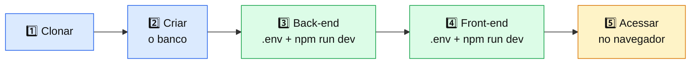

### 📋 Pré-requisitos

| Ferramenta | Versão | Para que serve | Como conferir |
|------------|--------|----------------|---------------|
| [Git](https://git-scm.com) | Qualquer recente | Clonar o repositório | `git --version` |
| [Node.js](https://nodejs.org) | LTS recente (22 ou superior recomendado) | Rodar back-end e front-end | `node --version` |
| npm | Já vem com o Node.js | Instalar dependências | `npm --version` |
| [MySQL Server](https://dev.mysql.com/downloads/mysql/) | 8 ou superior | Banco de dados | `mysql --version` |
| [MySQL Workbench](https://dev.mysql.com/downloads/workbench/) | Opcional | Executar os scripts SQL com interface | |

### 1️⃣ Clonar o repositório

```bash
git clone https://github.com/Protagonistas-ADS/PI-2.git
cd PI-2
```

### 2️⃣ Criar o banco de dados

Os scripts ficam em `backend/src/database/`:

| Arquivo | O que faz | Obrigatório |
|---------|-----------|:-----------:|
| `schema.sql` | Cria o banco `PI2` e todas as tabelas | ✅ |
| `seed.sql` | Insere os dados de demonstração: 8 usuários, 4 produtos, 15 pedidos em todos os status, 6 vendas, 5 notas e 24 movimentações (datas relativas ao dia em que roda; estoque = entradas − saídas) | Recomendado |
| `migracao-remover-cotacao.sql` | Só para quem já tinha o banco antigo: remove as tabelas de cotação sem mexer no resto | Só se o banco é antigo |
| `migracao-imagens-produto.sql` | Só para quem já tinha o seed antigo: corrige o caminho das imagens dos produtos | Só se o banco é antigo |
| `migracao-status-pedido.sql` | Só para quem já tinha o banco antigo: novo fluxo de status do pedido (tira o `respondido`) e coluna `observacao` | Só se o banco é antigo |
| `migracao-imagem-padrao-produto.sql` | Só para quem já tinha o seed antigo: tira o logo da equipe das fotos dos produtos (o site mostra a foto padrão de paletes) | Só se o banco é antigo |
| `migracao-movimentacao-nota.sql` | Só para quem já tinha o banco antigo: movimentação com responsável, motivo e pedido; nota fiscal com status e link do Emitte | Só se o banco é antigo |

<details open>
<summary><b>Opção A: MySQL Workbench</b></summary>

<br>

1. Abra uma conexão com o seu servidor MySQL.
2. Menu **File → Open SQL Script** e escolha o `schema.sql`.
3. Clique no raio ⚡ para executar.
4. Repita com o `seed.sql` (dados de demonstração). Pelo Workbench os acentos saem certos.

> Para começar do zero com os dados de demonstração, apague o banco antes (`DROP DATABASE PI2;`) e rode os dois scripts de novo. Isso apaga tudo o que estava no banco.

</details>

<details>
<summary><b>Opção B: terminal</b></summary>

<br>

```bash
mysql -u SEU_USUARIO -p < backend/src/database/schema.sql
mysql -u SEU_USUARIO -p < backend/src/database/seed.sql
```

</details>

Para conferir se deu certo:

```sql
USE PI2;
SHOW TABLES;
```

### 3️⃣ Configurar e rodar o back-end

```bash
cd backend
npm install
```

Crie o arquivo `.env` a partir do exemplo:

| Sistema | Comando |
|---------|---------|
| 🐧🍎 Linux, macOS e Git Bash | `cp .env.example .env` |
| 🪟 Windows (PowerShell ou CMD) | `copy .env.example .env` |

Preencha o `.env` com os seus dados:

```env
PORT=3000
DB_HOST=localhost
DB_PORT=3306
DB_NAME=PI2
DB_USER=root
DB_PASS=sua_senha_do_mysql
JWT_SECRET=uma_chave_longa_e_aleatoria
CORS_ORIGIN=http://localhost:5173
```

| Variável | Descrição |
|----------|-----------|
| `PORT` | Porta em que a API vai rodar |
| `DB_HOST` | Endereço do MySQL (`localhost` na sua máquina) |
| `DB_PORT` | Porta do MySQL (padrão `3306`) |
| `DB_NAME` | Nome do banco (`PI2`) |
| `DB_USER` | Usuário do MySQL |
| `DB_PASS` | Senha do MySQL |
| `JWT_SECRET` | Chave usada para assinar os tokens de login. Use um texto longo e aleatório e **nunca** compartilhe |
| `CORS_ORIGIN` | Endereço do front-end que pode chamar a API (padrão `http://localhost:5173`). Para mais de um, separe por vírgula. Se o front rodar em outra porta, ajuste aqui |

> [!WARNING]
> O arquivo `.env` guarda segredos e **não deve ser enviado ao GitHub**. Ele já está no `.gitignore`.

Inicie o servidor:

```bash
npm run dev
```

Se tudo estiver certo, o terminal mostra:

```text
Conexão com o banco estabelecida.
Servidor rodando em http://localhost:3000
Site autorizado (CORS): http://localhost:5173
```

### 4️⃣ Configurar e rodar o front-end

Abra um **segundo terminal** (deixe o back-end rodando no primeiro):

```bash
cd frontend
npm install
```

Crie o `.env`:

| Sistema | Comando |
|---------|---------|
| 🐧🍎 Linux, macOS e Git Bash | `cp .env.example .env` |
| 🪟 Windows (PowerShell ou CMD) | `copy .env.example .env` |

```env
VITE_API_URL=http://localhost:3000
```

> [!TIP]
> A URL precisa ter a mesma porta definida no `PORT` do back-end. Se mudar o `.env` do front, reinicie o `npm run dev`.

Depois:

```bash
npm run dev
```

### 5️⃣ Acessar o sistema

Abra no navegador o endereço que o Vite mostrar no terminal (normalmente **http://localhost:5173**).

| Serviço | Endereço padrão |
|---------|-----------------|
| 🖥️ Front-end | http://localhost:5173 |
| ⚙️ Back-end (API) | http://localhost:3000 |

Com o `seed.sql` rodado, já existem estas contas de teste:

| Perfil | E-mail | Senha |
|--------|--------|-------|
| 👑 Administrador | `admin@teste.com` | `Admin@123456` |
| 🛒 Cliente | `usuario@gmail.com` | `Cliente@123456` |

Os outros clientes do seed (empresas e pessoas fictícias, como `compras@rotasul.com.br` e `anapaula.ribeiro@outlook.com`) usam a mesma senha `Cliente@123456`. São contas só para teste: não use essas senhas em um servidor público.

Também dá para criar uma conta pela tela de **Cadastro**. Todo cadastro novo entra com o perfil `cliente`.

<details>
<summary><b>👑 Criando um administrador (ambiente de desenvolvimento)</b></summary>

<br>

Por segurança, não existe cadastro de admin pela API. Crie uma conta normalmente e promova ela direto no banco:

```sql
USE PI2;
UPDATE usuario SET perfil = 'administrador' WHERE email = 'seu-email@exemplo.com';
```

</details>

<details>
<summary><b>📜 Scripts disponíveis</b></summary>

<br>

| Pasta | Comando | O que faz |
|-------|---------|-----------|
| `backend` | `npm run dev` | Servidor com recarga automática |
| `backend` | `npm run build` | Compila o TypeScript para a pasta `dist` |
| `frontend` | `npm run dev` | Servidor de desenvolvimento |
| `frontend` | `npm run build` | Confere os tipos (`tsc --noEmit`) e gera o build de produção; erro de tipo impede o build |
| `frontend` | `npm run typecheck` | Só confere os tipos, sem gerar arquivos |
| `frontend` | `npm run preview` | Visualiza o build de produção |
| `frontend` | `npm run lint` | Verifica o código `.ts/.tsx` com o oxlint (regras em `frontend/.oxlintrc.json`) |

</details>

<details>
<summary><b>🛟 Problemas comuns</b></summary>

<br>

| Mensagem ou sintoma | Causa provável | Como resolver |
|---------------------|----------------|---------------|
| `Variáveis de ambiente faltando` | `.env` do back-end ausente ou incompleto | Confira se o arquivo existe em `backend/` e se as 5 variáveis `DB_*` estão preenchidas |
| `JWT_SECRET não configurada` | Falta o `JWT_SECRET` no `.env` | Adicione a variável e reinicie o servidor |
| `Access denied for user` | Usuário ou senha do MySQL errados | Revise `DB_USER` e `DB_PASS` |
| `Unknown database 'PI2'` | O `schema.sql` não foi executado | Execute o script do passo 2 |
| `ECONNREFUSED` ao conectar no banco | MySQL desligado ou porta errada | Inicie o serviço do MySQL e confira `DB_PORT` |
| `EADDRINUSE` | A porta já está em uso | Troque o `PORT` no `.env` (e o `VITE_API_URL` no front) |
| Front não carrega dados ou dá `Network Error` | Back-end desligado ou `VITE_API_URL` errada | Confirme que o back está rodando e a URL no `.env` do front; reinicie o `npm run dev` do front após mudar o `.env` |
| Login funciona, mas volta para a tela de login | Token inválido ou expirado | Faça login de novo (o token dura 8 horas) |

</details>

<div align="right"><a href="#topo">⬆️ voltar ao topo</a></div>

---

## 📂 Estrutura de pastas

<details open>
<summary><b>Ver a árvore do projeto</b></summary>

<br>

```text
PI-2/
├── 📁 backend/
│   └── src/
│       ├── configs/        # conexão com o banco
│       ├── controllers/
│       ├── database/       # schema.sql, seed.sql e migrações
│       ├── middlewares/
│       ├── repositories/
│       ├── routes/
│       ├── schemas/        # validações Zod
│       ├── services/
│       ├── types/
│       ├── utils/
│       ├── app.ts
│       └── index.ts
│   ├── requests/           # exemplos de chamadas à API (.http)
│   └── uploads/            # fotos dos produtos
├── 📁 docs/
│   ├── diagramas.md        # banco, casos de uso, classes e ciclo do pedido
│   ├── roteiro-de-teste.md # teste do fluxo completo, passo a passo
│   ├── roteiro-de-apresentacao.md # ordem da demo e quem fala
│   └── prints/             # capturas das telas
├── 📁 frontend/
│   └── src/
│       ├── assets/
│       ├── components/     # componentes reutilizáveis
│       ├── hooks/          # carrinho compartilhado
│       ├── pages/          # Admin/, Cliente/ e Compartilhadas/
│       ├── routes/
│       ├── services/       # chamadas à API
│       ├── types/          # tipos compartilhados
│       ├── utils/
│       └── App.tsx
└── 📄 README.md
```

</details>

<div align="right"><a href="#topo">⬆️ voltar ao topo</a></div>

---

## 🤝 Fluxo de trabalho da equipe

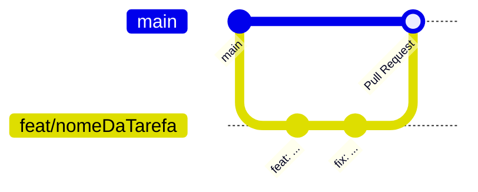

- 🌳 A branch **`main`** é a versão oficial do projeto.
- 🔀 Cada tarefa é feita em uma branch própria, como `feat/nomeDaTarefa`, e entra na `main` por **Pull Request**.
- ✍️ Os commits seguem o padrão [Conventional Commits](https://www.conventionalcommits.org/pt-br/):

| Prefixo | Uso |
|---------|-----|
| ✨ `feat:` | Nova funcionalidade |
| 🐛 `fix:` | Correção de bug |
| ♻️ `refactor:` | Melhoria de código sem mudar o comportamento |
| 📝 `docs:` | Documentação |
| 🔧 `chore:` | Manutenção (dependências, configs) |

<details>
<summary><b>💡 Exemplo de ciclo completo</b></summary>

<br>

```bash
git checkout main
git pull origin main
git checkout -b feat/rotasEstoque

# ...desenvolve...

git add .
git commit -m "feat: adiciona rotas de listagem de estoque"
git push -u origin feat/rotasEstoque
# abre o Pull Request no GitHub
```

</details>

<div align="right"><a href="#topo">⬆️ voltar ao topo</a></div>

---

## 📈 Status e roadmap

Legenda: ✅ pronto · 🚧 em andamento · ⏳ a fazer

| Área | Progresso | Módulos prontos |
|------|-----------|:---------------:|
| ⚙️ Back-end | `▰▰▰▰▰▰▰▰` | 8 de 8 |
| 🖥️ Front-end | `▰▰▰▰▰▰▰▰` | 8 de 8 |

<table>
<tr>
<td width="50%" valign="top">

### ⚙️ Back-end

| Módulo | Status |
|--------|:------:|
| Usuário (cadastro, login, perfil) | ✅ |
| Middlewares (token, perfil admin, validação, erros) | ✅ |
| Pedido (visão do cliente) | ✅ |
| Produto (catálogo público, cadastro, edição, ativar/desativar) | ✅ |
| Estoque e movimentações (responsável, motivo e pedido) | ✅ |
| Pedido (visão do admin: listar, ver itens e mudar status) + resumo do dashboard | ✅ |
| Venda (automática na entrega + listagem) | ✅ |
| Nota fiscal (status, link do Emitte, cancelar) | ✅ |

</td>
<td width="50%" valign="top">

### 🖥️ Front-end

| Tela | Status |
|------|:------:|
| Tela inicial, cadastro e login | ✅ |
| Catálogo e carrinho | ✅ |
| Página do carrinho e envio do pedido | ✅ |
| Perfil do usuário | ✅ |
| Meus Pedidos do cliente | ✅ |
| Painel do admin: menu, dashboard de pedidos e perfil | ✅ |
| Tabelas do administrador: pedidos e usuários | ✅ |
| Tabelas do administrador: movimentações, vendas e notas | ✅ |

</td>
</tr>
</table>

### 🗓️ Cronograma

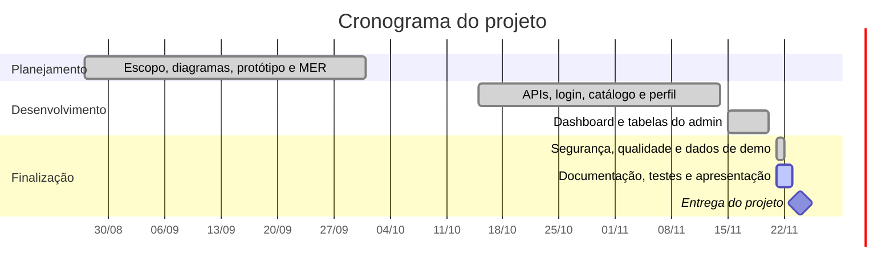

| Período | Entrega |
|---------|---------|
| 27/08 a 01/10 | Planejamento, escopo, diagramas, protótipo de telas, banco (MER) |
| 15/10 a 14/11 | Desenvolvimento: APIs, login, catálogo, perfil, pedidos e cotações |
| 15/11 a 20/11 | Dashboard e tabelas do administrador |
| 21/11 | Segurança (CORS, limite de login, Helmet), qualidade do código e dados de demonstração |
| 21/11 a 23/11 | Documentação, diagramas, testes do fluxo completo e ensaio da apresentação |
| **24/11** | **🏁 Entrega do projeto** |

<div align="right"><a href="#topo">⬆️ voltar ao topo</a></div>

---

## 🔭 Melhorias futuras

Itens levantados durante o projeto que ficaram **fora do escopo desta entrega**, de propósito, para priorizar o que o cliente e o professor pediram:

| # | Melhoria | Por que importa | Esforço |
|:-:|----------|-----------------|:-------:|
| L18 | Telefone do cliente no cadastro + texto de privacidade (**LGPD**) | Facilita o contato da loja e deixa claro como os dados são usados. As tabelas `telefone` e `endereco` já existem no banco | médio |
| L19 | Tela de produtos no painel, com **upload de imagem** (`multer`) | Hoje produtos são cadastrados e editados pela API; com a tela, o próprio cliente troca fotos e preços | médio |
| L20 | **Índices extras e regras `CHECK`** no banco (ex.: quantidade > 0) | Consultas mais rápidas com muitos dados e uma segunda barreira contra dados inválidos | baixo |
| L21 | **Testes automatizados** (Vitest) | Conferem sozinhos, a cada mudança, que as regras de pedido, estoque e nota continuam certas | alto |
| — | Dividir o pacote do front-end (*code splitting*) | O build avisa que o JavaScript passa de 500 KB; dividir deixa a primeira abertura mais rápida | baixo |
| — | Publicar na internet (HTTPS, domínio, `trust proxy`, `JWT_SECRET` forte) | Hoje o sistema roda localmente; veja também as [melhorias de segurança previstas](#-segurança-da-informação) | médio |
| — | Fotos reais dos paletes, preços reais e horário de sábado | Dependem de informações do cliente (hoje: foto padrão, preços de exemplo e "segunda a sexta, das 7h às 18h") | baixo |

**💡 Ideias para versões seguintes:** gerenciamento de compras, perfil de RH para colaboradores, gerenciamento de entregas e frete.

<div align="right"><a href="#topo">⬆️ voltar ao topo</a></div>

---

## 👥 Equipe

<div align="center">

| 👨‍💻 | 👨‍💻 | 👨‍💻 | 👨‍💻 | 👨‍💻 |
|:---:|:---:|:---:|:---:|:---:|
| **Yuri Tavares** | **Antonio Miguel Souza Marques** | **Davi Aurélio de Pontes Lopes** | **Gustavo Henrique Teles** | **Henrique Domingues** |
| ⚙️ Back-end<br>Rotas de estoque | ⚙️ Back-end<br>Rotas de cotação | 🖥️ Front-end<br>🗄️ Banco de dados<br>👤 Rotas de usuário | 🖥️ Front-end<br>🗄️ Banco de dados<br>🛒 Pedido, venda e nota fiscal | 🗄️ Banco de dados<br>📦 Rotas de produto |

</div>

| Área | Integrantes |
|------|-------------|
| ⚙️ Back-end | Yuri Tavares, Antonio Miguel Souza Marques |
| 🖥️ Front-end | Davi Aurélio de Pontes Lopes, Gustavo Henrique Teles |
| 🗄️ Banco de dados | Henrique Domingues, Gustavo Henrique Teles, Davi Aurélio de Pontes Lopes |

<div align="right"><a href="#topo">⬆️ voltar ao topo</a></div>

---

## 📄 Licença

Distribuído sob a licença **MIT**. Veja o arquivo [`LICENSE`](LICENSE).

---

<div align="center">

Feito com 💛 pela equipe **Protagonistas ADS** · FATEC

⭐ Se o projeto te interessou, deixe uma estrela no repositório!

</div>
