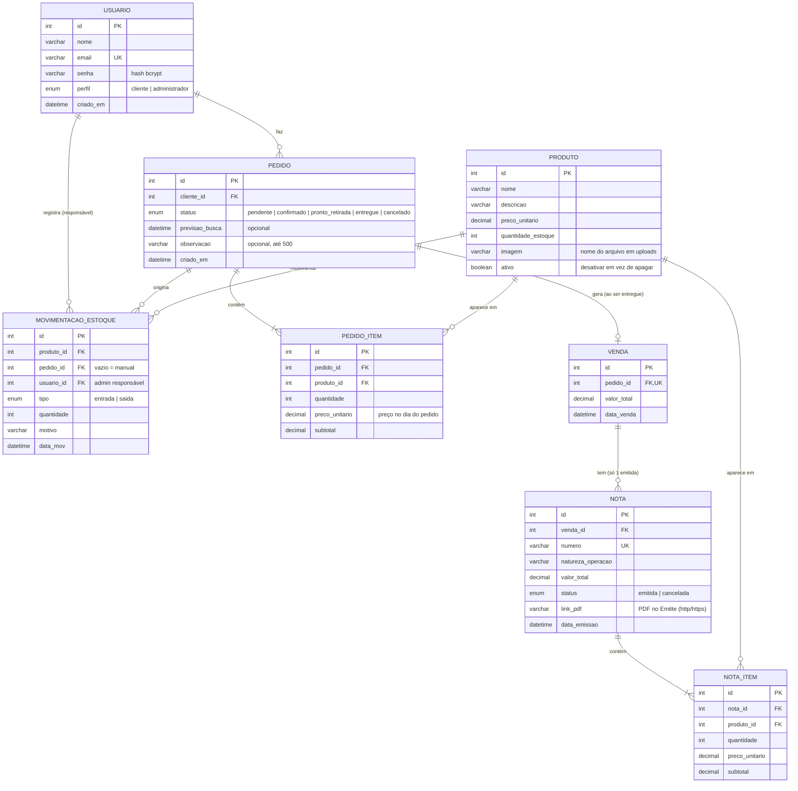
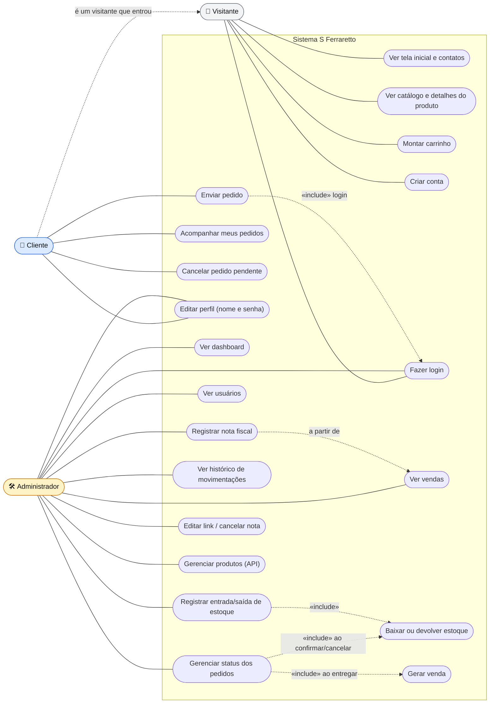
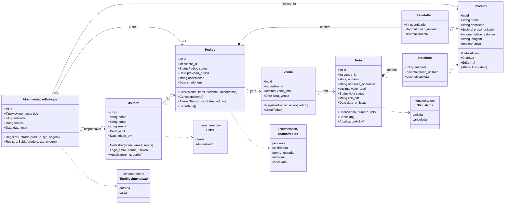
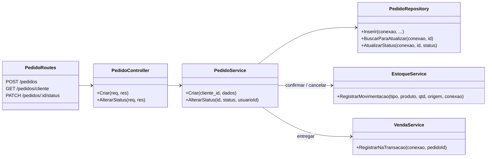
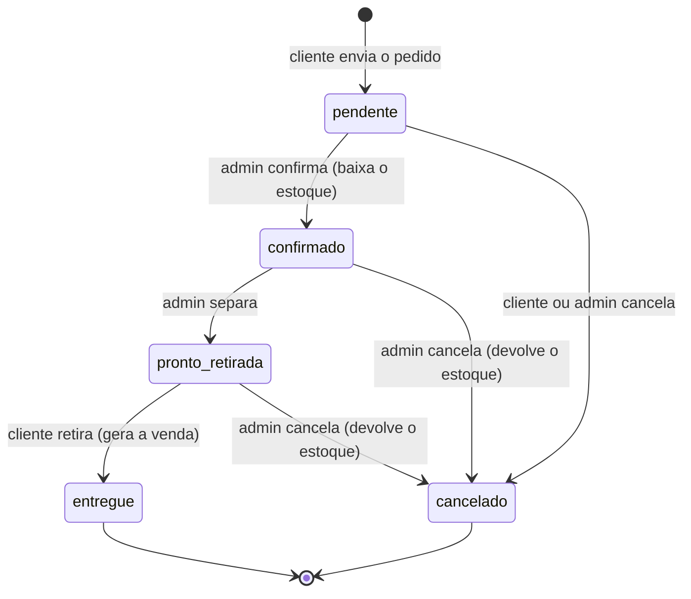

# 📐 Diagramas do PI-2 (S Ferraretto)

Diagramas da versão final do sistema, **sem cotação**. Foram escritos em [Mermaid](https://mermaid.js.org/), um formato de texto que o GitHub desenha sozinho. Assim eles ficam no mesmo repositório que o código e são atualizados no mesmo Pull Request.

> Fonte da verdade: o banco vem de [`backend/src/database/schema.sql`](../backend/src/database/schema.sql), as regras vêm de [`backend/src/services/`](../backend/src/services) e as rotas de [`backend/src/routes/`](../backend/src/routes). Se algo mudar lá, atualize aqui também.

- [1. Modelo do banco (MER / modelo lógico)](#1-modelo-do-banco-mer--modelo-lógico)
- [2. Diagrama de casos de uso](#2-diagrama-de-casos-de-uso)
- [3. Diagrama de classes](#3-diagrama-de-classes)
- [4. Ciclo de vida do pedido](#4-ciclo-de-vida-do-pedido)

---

## 1. Modelo do banco (MER / modelo lógico)

Banco `PI2` (MySQL) com **8 tabelas**. `PK` = chave primária, `FK` = chave estrangeira, `UK` = valor único.

**Regras importantes:**

- `movimentacao_estoque` **não tem mais `nota_id`**. A origem é o `pedido_id` (vazio = movimentação manual), o responsável é o `usuario_id` e o `motivo` é obrigatório nas manuais.
- `nota` tem `status` (emitida/cancelada) e `link_pdf`. Uma venda pode ter várias notas no histórico, mas **só uma emitida**. Essa regra é conferida no backend.
- `venda.pedido_id` é único: um pedido gera no máximo uma venda.
- Produtos não são apagados (`ativo = false`), para não quebrar pedidos, vendas e notas antigos.
- `telefone` e `endereco` **não existem no banco**: estão só planejadas (comentadas no `schema.sql`) para a melhoria futura de telefone no cadastro e frete (L18).

<b>📝 Lista para refazer o MER no BrModelo</b>

 

**Entidades e atributos** (sublinhado = identificador):

| Entidade | Atributos |
|---|---|
| Usuario | <u>id</u>, nome, email (único), senha, perfil, criado_em |
| Produto | <u>id</u>, nome, descricao, preco_unitario, quantidade_estoque, imagem, ativo |
| Pedido | <u>id</u>, status, previsao_busca, observacao, criado_em |
| Venda | <u>id</u>, valor_total, data_venda |
| Nota | <u>id</u>, numero (único), natureza_operacao, valor_total, status, link_pdf, data_emissao |
| Movimentacao_Estoque | <u>id</u>, tipo, quantidade, motivo, data_mov |

**Relacionamentos** (cardinalidade):

| Relacionamento | Entre | Cardinalidade | Atributos do relacionamento |
|---|---|---|---|
| faz | Usuario — Pedido | 1 : N | — |
| contém (pedido_item) | Pedido — Produto | N : N | quantidade, preco_unitario, subtotal |
| gera | Pedido — Venda | 1 : 0..1 | — |
| tem | Venda — Nota | 1 : N | — |
| contém (nota_item) | Nota — Produto | N : N | quantidade, preco_unitario, subtotal |
| movimenta | Produto — Movimentacao_Estoque | 1 : N | — |
| origina | Pedido — Movimentacao_Estoque | 0..1 : N | — |
| registra | Usuario — Movimentacao_Estoque | 0..1 : N | — |

**Não incluir:** cotação, item de cotação, status "respondido", a ligação entre nota e movimentação e as tabelas planejadas `telefone` e `endereco` (ainda não existem no banco).

---

## 2. Diagrama de casos de uso

O Mermaid não tem o "bonequinho" da UML. Por isso os atores e os casos de uso aparecem como caixas: os atores à esquerda e o sistema no meio. `«include»` quer dizer "sempre acontece junto".

| Ator | Quem é | O que pode fazer |
|---|---|---|
| Visitante | Qualquer pessoa, sem login | Tela inicial, catálogo, carrinho, criar conta, entrar |
| Cliente | Usuário com perfil `cliente` | Tudo do visitante + enviar pedido, acompanhar, cancelar pendente, editar perfil |
| Administrador | Usuário com perfil `administrador` (criado no banco) | Painel `/admin`: dashboard, pedidos, usuários, estoque, vendas, notas, perfil e produtos (pela API) |

---

## 3. Diagrama de classes

Classes do domínio, com os atributos vindos do banco e as operações vindas dos *services* do backend (onde ficam as regras de negócio).

<b>🏗️ Como as classes viram código (camadas do backend)</b>

 

Cada assunto (usuário, produto, pedido, estoque, venda, nota, admin) tem um arquivo em cada camada:

`routes` (endereço e middlewares de login, perfil e Zod) → `controllers` (recebe e responde HTTP) → `services` (regras) → `repositories` (SQL) → MySQL.

---

## 4. Ciclo de vida do pedido

